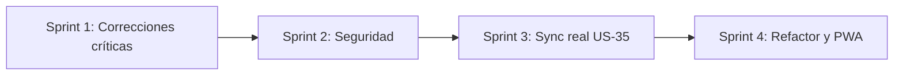

# 🔍 Auditoría de código: Food Assistant v0.15

> **Alcance**: [app.js](file:///c:/Users/fjcer/OneDrive/Apps/Designer/food-assistant/app.js) (3583 líneas), [index.html](file:///c:/Users/fjcer/OneDrive/Apps/Designer/food-assistant/index.html), [sw.js](file:///c:/Users/fjcer/OneDrive/Apps/Designer/food-assistant/sw.js), [server.ps1](file:///c:/Users/fjcer/OneDrive/Apps/Designer/food-assistant/server.ps1), [schema.sql](file:///c:/Users/fjcer/OneDrive/Apps/Designer/food-assistant/replica/schema.sql), [manifest.json](file:///c:/Users/fjcer/OneDrive/Apps/Designer/food-assistant/manifest.json), `package.json`, `tests/`.
> **Estado**: solo informe. **No se ha modificado ningún archivo.**

**Leyenda**: 🔴 Crítico / Alto · 🟡 Medio · 🟢 Bajo

---

## 1. Resumen ejecutivo

| Área | Hallazgos | Lo más grave |
| :--- | :---: | :--- |
| 🐛 Errores funcionales | 12 | El Service Worker nunca se registra (la app **no** funciona offline). Las fechas se calculan en UTC. El plan semanal no avanza de semana. |
| 🔒 Seguridad | 7 | XSS almacenado a través de recetas importadas y de las respuestas de Gemini. |
| ☁️ Sincronización Supabase | 6 | Solo sube datos (nunca descarga), los errores se ignoran y los IDs de las recetas de ejemplo colisionan entre usuarios. |
| 🧱 Deuda técnica | 8 | Un único archivo de 3.600 líneas, IDs basados en `Date.now()` y la versión duplicada en 6 sitios. |
| ♿ UX y accesibilidad | 7 | No se puede hacer zoom, hay `div` clicables sin soporte de teclado y los modales no gestionan el foco. |

---

## 2. 🐛 Errores funcionales confirmados

### 🔴 BUG-A: el Service Worker nunca se registra
- `sw.js` existe, pero ningún archivo llama a `navigator.serviceWorker.register(...)`. Solo aparece `unregister()` en [forceUpdateApp](file:///c:/Users/fjcer/OneDrive/Apps/Designer/food-assistant/app.js#L1217-L1235).
- **Consecuencia**: la promesa "100% Offline (PWA)" del README no se cumple y la app tampoco se puede instalar en condiciones.
- **Arreglo**: registrar el SW al final de [index.html](file:///c:/Users/fjcer/OneDrive/Apps/Designer/food-assistant/index.html#L884-L885) y precachear también las fuentes de Material Symbols y el script de Supabase (si no, los iconos desaparecen sin conexión).

### 🔴 BUG-B: las fechas se calculan en UTC, no en hora local
- `new Date().toISOString().split('T')[0]` devuelve la fecha UTC. En España (UTC+1/+2), entre las 00:00 y las 01:00/02:00 la app cree que "hoy" es **ayer**.
- Aparece en [L284](file:///c:/Users/fjcer/OneDrive/Apps/Designer/food-assistant/app.js#L284), [L1672](file:///c:/Users/fjcer/OneDrive/Apps/Designer/food-assistant/app.js#L1672), [L2230](file:///c:/Users/fjcer/OneDrive/Apps/Designer/food-assistant/app.js#L2230) y [L2407](file:///c:/Users/fjcer/OneDrive/Apps/Designer/food-assistant/app.js#L2407).
- **Arreglo**: una función `toLocalDateKey(d)` que use `getFullYear()`, `getMonth()` y `getDate()`.

### 🔴 BUG-C: el plan semanal se queda congelado en la primera semana
- [generateInitialMealPlan](file:///c:/Users/fjcer/OneDrive/Apps/Designer/food-assistant/app.js#L276-L295) solo se ejecuta si no hay nada guardado. Pasados 7 días, el planificador sigue mostrando fechas pasadas y nunca genera la semana actual.
- Además empieza "desde hoy" y no desde el lunes, lo que choca con US-22.
- Encima, [renderTodayView](file:///c:/Users/fjcer/OneDrive/Apps/Designer/food-assistant/app.js#L1673-L1679) se **inventa** un plan cuando hoy no existe (pone `recipes[0]` en el almuerzo y `recipes[1]` en la cena). El usuario ve comidas que nunca planificó.
- **Arreglo**: calcular la semana visible a partir de la fecha actual (de lunes a domingo, con navegación ±1 semana) y crear las claves bajo demanda. Esto encaja directamente con US-05 y US-22.

### 🔴 BUG-D: al editar una receta importada se pierde la fuente original
- [saveRecipeEdit](file:///c:/Users/fjcer/OneDrive/Apps/Designer/food-assistant/app.js#L2091-L2102) crea el objeto desde cero, sin `sourceUrl` ni `sourceDomain`, y reemplaza el original. Rompe un criterio de aceptación de US-15.
- **Arreglo**: `{ ...existing, ...camposEditados }`.

### 🔴 BUG-E: las recetas de ejemplo borradas vuelven a aparecer
- El constructor de `StateStore` ([L215-L225](file:///c:/Users/fjcer/OneDrive/Apps/Designer/food-assistant/app.js#L215-L225)) vuelve a añadir cada receta semilla que falte **en cada arranque**. Si el usuario borra "Pasta al Pesto", reaparece al recargar.
- **Arreglo**: guardar una bandera `fa_seed_version` y fusionar las semillas solo una vez por versión.
- Relacionado: [resetDemoData](file:///c:/Users/fjcer/OneDrive/Apps/Designer/food-assistant/app.js#L3551) asigna `state.recipes = SEED_RECIPES` por referencia, así que cualquier edición posterior modifica la constante. Hay que usar `structuredClone(SEED_RECIPES)`.

### 🔴 BUG-F: el temporizador del Modo Cocina falla al cambiar de paso
- [renderCookStep](file:///c:/Users/fjcer/OneDrive/Apps/Designer/food-assistant/app.js#L2158) y [exitCookMode](file:///c:/Users/fjcer/OneDrive/Apps/Designer/food-assistant/app.js#L2127-L2130) hacen `clearInterval` pero **no ponen `timerInterval = null`**. En el paso siguiente, [toggleCookTimer](file:///c:/Users/fjcer/OneDrive/Apps/Designer/food-assistant/app.js#L2184-L2204) cree que el temporizador sigue en marcha: el primer toque en "Iniciar" lo "pausa" y muestra "Reanudar".
- El texto del botón tampoco vuelve a "Iniciar" al cambiar de paso.
- Si una receta importada no tiene pasos, `renderCookStep` lanza un error (`step` es `undefined`).
- `setInterval` se retrasa o se congela cuando el móvil bloquea la pantalla. Es mejor calcular el tiempo restante a partir de una marca de tiempo de fin.

### 🟡 BUG-G: el escalado de raciones de la compra desde el plan es incoherente
- En [openShoppingPreviewForPlan](file:///c:/Users/fjcer/OneDrive/Apps/Designer/food-assistant/app.js#L2759-L2783), la cantidad inicial usa `defaultServings / recipe.servings`. Pero [stepShoppingPreviewServings](file:///c:/Users/fjcer/OneDrive/Apps/Designer/food-assistant/app.js#L2891-L2909) recalcula con `baseAmount * new / defaultServings` y se olvida de `recipe.servings`.
- **Ejemplo**: receta para 4, raciones por defecto 2. Al abrir se muestran 0,5× las cantidades; al pulsar "+" (3 raciones) se pasa a **1,5×** en lugar de 0,75×.
- **Arreglo**: guardar `baseServings` en cada grupo y escalar con `item.baseAmount * new / group.baseServings`.

### 🟡 BUG-H: el tiempo total de las recetas importadas sale inflado
- [L801](file:///c:/Users/fjcer/OneDrive/Apps/Designer/food-assistant/app.js#L801): `cookTime || totalTime`. Si la web solo publica `totalTime`, la UI muestra `prep + total`, es decir, la preparación cuenta dos veces.
- `parseIsoDuration` devuelve **15** cuando no hay dato, así que se inventan tiempos.

### 🟡 BUG-I: la clasificación por pasillo falla por no usar límites de palabra
- En la compra manual ([L2644-L2653](file:///c:/Users/fjcer/OneDrive/Apps/Designer/food-assistant/app.js#L2644-L2653)), la regex `te|té` captura "chocola**te**" y "file**te**", que acaban en **Bebidas**. `pan` captura "**pan**ceta".
- En el parser ([L334-L352](file:///c:/Users/fjcer/OneDrive/Apps/Designer/food-assistant/app.js#L334-L352)), `sal` captura "**sal**sa" y `ajo` captura "b**ajo**". Además, "pasta" va a `bakery` mientras que las recetas semilla la tienen en `pantry`.
- Hay **dos clasificadores distintos**. Conviene unificarlos en un diccionario con `\b` y normalización de acentos (`normalize('NFD')`).

### 🟡 BUG-J: el botón "Aplicar este menú" ignora lo que propone Gemini
- [applySampleAiPlan](file:///c:/Users/fjcer/OneDrive/Apps/Designer/food-assistant/app.js#L3151-L3171) reparte las recetas en orden rotatorio, sin tener en cuenta la respuesta de la IA. El usuario cree que aplica el menú de Gemini y no es así.
- Los filtros `|| !r.tags.includes('Desayuno')` meten las meriendas en almuerzos y cenas.

### 🟢 Otros errores menores
- **Importar dos veces la misma URL** crea recetas duplicadas: [confirmSaveImportRecipe](file:///c:/Users/fjcer/OneDrive/Apps/Designer/food-assistant/app.js#L3458-L3468) no comprueba `sourceUrl`.
- **Días creados desde "Añadir comida"** fuera del plan quedan con `dayName: ''` ([L2416-L2425](file:///c:/Users/fjcer/OneDrive/Apps/Designer/food-assistant/app.js#L2416-L2425)). El planificador tampoco ordena las fechas.
- **La búsqueda y los chips de etiqueta no se combinan**: cada filtro descarta el otro. La búsqueda tampoco mira ingredientes.
- **`copyShoppingList`** no gestiona el rechazo de `navigator.clipboard`, que falla en HTTP o sin permiso.
- **`password.trim()`** ([L1376](file:///c:/Users/fjcer/OneDrive/Apps/Designer/food-assistant/app.js#L1376)) cambia contraseñas que empiezan o terminan con espacios.

---

## 3. 🔒 Seguridad

| # | Sev. | Problema | Dónde | Recomendación |
| :--- | :---: | :--- | :--- | :--- |
| S1 | 🔴 | **XSS almacenado**: título, descripción, ingredientes, etiquetas e `imageUrl` de webs importadas se insertan con `innerHTML` sin escapar. Una receta maliciosa (o un backup JSON manipulado) puede ejecutar JS y robar la sesión de Supabase o la clave de Gemini. | [renderRecipesGrid](file:///c:/Users/fjcer/OneDrive/Apps/Designer/food-assistant/app.js#L1769-L1790), [renderRecipeModalContent](file:///c:/Users/fjcer/OneDrive/Apps/Designer/food-assistant/app.js#L1842-L1928), [addIngredientRow](file:///c:/Users/fjcer/OneDrive/Apps/Designer/food-assistant/app.js#L1998), slots, compra | Función `escapeHtml()` en todas las interpolaciones, o pasar a `textContent` y plantillas DOM. |
| S2 | 🔴 | **Enlaces `javascript:`**: `sourceUrl` puede venir de `schema.mainEntityOfPage` y se pinta en `href` sin validar. | [L1850](file:///c:/Users/fjcer/OneDrive/Apps/Designer/food-assistant/app.js#L1850), [L3432](file:///c:/Users/fjcer/OneDrive/Apps/Designer/food-assistant/app.js#L3432) | Aceptar solo `http:` y `https:` mediante `new URL()`. |
| S3 | 🔴 | **La respuesta de Gemini se pinta como HTML**. Un título de receta con instrucciones ocultas (prompt injection) puede hacer que el modelo devuelva ``. Lo mismo ocurre con `err.message`. | [L3133](file:///c:/Users/fjcer/OneDrive/Apps/Designer/food-assistant/app.js#L3133), [L3145](file:///c:/Users/fjcer/OneDrive/Apps/Designer/food-assistant/app.js#L3145) | Escapar primero y aplicar después el markdown mínimo, o usar un sanitizador (DOMPurify o la Sanitizer API). |
| S4 | 🟡 | **Login simulado**: sin Supabase, cualquiera "inicia sesión" con cualquier email y la UI dice "cuenta conectada". Además hay un **email personal escrito en el código** (`frankyjcerrudo@gmail.com`). | [L1422-L1430](file:///c:/Users/fjcer/OneDrive/Apps/Designer/food-assistant/app.js#L1422-L1430), [L1454](file:///c:/Users/fjcer/OneDrive/Apps/Designer/food-assistant/app.js#L1454) | Eliminar el modo simulado o etiquetarlo claramente como "Demo", y quitar el email. |
| S5 | 🟡 | **La clave de Gemini va en la URL** (`?key=`), así que queda en logs e historial. Además se guarda en `localStorage`, expuesta a cualquier XSS (S1). | [L3049](file:///c:/Users/fjcer/OneDrive/Apps/Designer/food-assistant/app.js#L3049) | Usar la cabecera `x-goog-api-key`. A medio plazo, un proxy (p. ej. una Supabase Edge Function) para no exponer la clave en el cliente. Esto encaja con el modelo Premium de US-30. |
| S6 | 🟡 | **`/api/fetch` con `CORS: *`**: cualquier web abierta en el navegador puede usar tu servidor local como proxy hacia tu red interna (SSRF), por ejemplo `http://192.168.1.1`. | [server.ps1 L31-L34](file:///c:/Users/fjcer/OneDrive/Apps/Designer/food-assistant/server.ps1#L31-L34) | Limitar `Access-Control-Allow-Origin` a `http://localhost:3000` y bloquear IPs privadas y `localhost` como destino. |
| S7 | 🟢 | Script de Supabase desde CDN **sin versión fija ni SRI** (`@2`), y servidor estático sin comprobación explícita de path traversal ([L84](file:///c:/Users/fjcer/OneDrive/Apps/Designer/food-assistant/server.ps1#L84)). | [index.html L15](file:///c:/Users/fjcer/OneDrive/Apps/Designer/food-assistant/index.html#L15) | Fijar la versión exacta con `integrity=`. Verificar que la ruta resuelta empieza por `$root`. |

> [!NOTE]
> Que `supabaseAnonKey` esté en [config.js](file:///c:/Users/fjcer/OneDrive/Apps/Designer/food-assistant/config.js) es correcto: es una clave pública. La seguridad depende por completo de las políticas RLS, que sí están definidas.

---

## 4. ☁️ Sincronización con Supabase

El código de [syncDataWithCloud](file:///c:/Users/fjcer/OneDrive/Apps/Designer/food-assistant/app.js#L1483-L1522) está lejos de lo que pide US-35:

1. 🔴 **Solo sube, nunca descarga**: al entrar desde otro dispositivo no se recupera nada.
2. 🔴 **Solo sincroniza recetas**: el plan y la compra nunca se envían, aunque la función se llama al marcar cada artículo.
3. 🔴 **Los errores se ignoran**: `supabase-js` no lanza excepciones, devuelve `{ error }`, y el código no lo comprueba. Aun así guarda `lastSyncedAt` y muestra "Sincronizado", incluso sin sesión.
4. 🔴 **Los IDs de las recetas semilla colisionan**: `recipes.id` es `text primary key` global y todas las cuentas comparten `"rec-pesto-pasta"`. La RLS bloquea el `upsert` del segundo usuario sin avisar. Solución: clave compuesta `(user_id, id)` o UUID por usuario.
5. 🟡 **Rendimiento**: cada clic hace **N peticiones secuenciales** (una por receta). Es mejor un único `upsert([...])` en lote, con *debounce* y solo de los cambios ("dirty tracking").
6. 🟡 **El esquema no coincide con el modelo**: `meal_plans` solo tiene `lunch` y `dinner` (faltan `breakfast`, `snack` y `customSlots`). `recipes` no tiene `source_url` ni `source_domain`. `shopping_items` exige un `id` que los artículos locales no tienen. Los borrados tampoco se propagan a la nube.

Además, en `signUp` ([L1400-L1406](file:///c:/Users/fjcer/OneDrive/Apps/Designer/food-assistant/app.js#L1400-L1406)), si Supabase exige confirmar el email, `data.session` es `null`, pero la UI marca al usuario como conectado.

> [!TIP]
> Propuesta de diseño para US-35: una cola de operaciones pendientes (*outbox*) en IndexedDB, un campo `updated_at` en cada entidad y la regla "gana el cambio más reciente". Con **Supabase Realtime** se cubriría también la lista de la compra compartida (US-08).

---

## 5. 🧱 Deuda técnica y arquitectura

| Sev. | Tema | Detalle y propuesta |
| :---: | :--- | :--- |
| 🟡 | **Archivo monolítico** | `app.js` mezcla datos semilla, parser, store, UI, IA y sync. Propuesta: separarlo en módulos ES (`parser.js`, `store.js`, `sync.js`, `views/*.js`). Los tests podrían hacer `import` en vez de `new Function(appCode)()`. |
| 🟡 | **Handlers `onclick="app.…"` en línea** | Dependen de la variable global `window.app` e impiden usar una CSP estricta. Propuesta: delegar eventos en el contenedor con `data-action`. |
| 🟡 | **`render()` lo vuelve a pintar todo** | Cada cambio repinta las 5 vistas. Propuesta: pintar solo la vista activa y la que haya cambiado. |
| 🟡 | **IDs con `Date.now()` y `Math.random().substr`** | Pueden colisionar al importar en ráfaga, y `substr` está obsoleto. Propuesta: `crypto.randomUUID()`. |
| 🟡 | **`localStorage`** | Es síncrono y tiene un límite de unos 5 MB, mientras que el README dice IndexedDB. Si se añaden fotos propias (US-16) se quedará corto. Propuesta: IndexedDB (con `idb-keyval` o similar). |
| 🟢 | **Versión duplicada en 6 sitios** | `sw.js` (×4), `index.html` (×4) y `test.html`, mientras `package.json` dice `1.0.0` (contradice la regla `0.x` de AGENTS.md). Propuesta: una sola constante `APP_VERSION` o un script que haga el *bump*. |
| 🟢 | **`npm run lint` es falso** | Solo hace `echo 'Linting passed.'`. Propuesta: ESLint + Prettier en la CI. |
| 🟢 | **Estilos en línea masivos** | Cientos de `style="…"` dentro de las plantillas JS. Propuesta: moverlos a clases de `styles.css` (prepara también US-23 y US-24). |
| 🟢 | **`test.html` (73 KB)** | Arnés de tests en navegador paralelo a Vitest, con riesgo de que diverjan. Conviene valorar si sigue aportando. |

**Cobertura de tests**: el parser está bien cubierto. Faltan tests para la sincronización, el escalado de la compra (habría detectado BUG-G), los cálculos de fecha (BUG-B y BUG-C) y el escapado HTML.

---

## 6. ♿ UX, accesibilidad y PWA

- 🟡 **`user-scalable=no, maximum-scale=1`** ([index.html L5](file:///c:/Users/fjcer/OneDrive/Apps/Designer/food-assistant/index.html#L5)) impide hacer zoom, un incumplimiento de WCAG que afecta sobre todo al modo cocina.
- 🟡 **Elementos clicables que son `div`** (slots, tarjetas, filas del selector) sin `role="button"`, `tabindex` ni soporte de teclado.
- 🟡 **Los modales no gestionan el foco ni se cierran con Esc**. Propuesta: usar `<dialog>` nativo con `showModal()`, que trae fondo, foco y Esc incluidos (sinergia con US-18).
- 🟡 **El manifest no es instalable en Android**: el icono es un SVG en data-URI con emoji. Hacen falta PNG de 192 y 512 px y uno `maskable`. `theme-color` no coincide (`#ffffff` en el HTML, `#c2410c` en el manifest) y el favicon es azul. Todo esto bloquea US-10 y US-26.
- 🟢 **Material Symbols carga todos los ejes** (`opsz, wght, FILL, GRAD`). Fijar valores o usar `&icon_names=` reduce mucho el peso.
- 🟢 **No se puede editar la previsualización de importación**: si el parser falla en un ingrediente, hay que guardar y luego editar.
- 🟢 **`alert()` y `confirm()` por todas partes** (ya recogido en US-18).

---

## 7. 💡 Ideas para el futuro (no están en el backlog)

| Idea | Valor | Esfuerzo |
| :--- | :--- | :---: |
| **Web Share Target**: compartir una URL desde Chrome, Instagram o TikTok directamente a la app (`share_target` en el manifest) y abrir el importador con el enlace ya relleno | 🔥 Gran mejora de la experiencia de importación | Bajo |
| **Screen Wake Lock en el Modo Cocina**: que la pantalla no se apague mientras cocinas | Muy pedido en apps de cocina | Muy bajo |
| **Varios temporizadores a la vez**, con notificación o vibración al terminar aunque la app esté en segundo plano | Cocina real (horno y sartén a la vez) | Medio |
| **Conversión y normalización de unidades** en la compra (500 g + 1 kg = 1,5 kg; "Tomate" = "Tomates") | Lista más limpia | Medio |
| **Gemini con salida estructurada (JSON Schema)** para que "Aplicar menú" use de verdad lo que propone la IA (arregla BUG-J) | Hace real la promesa principal | Medio |
| **Importación con IA como respaldo**: si falla el parser JSON-LD/texto, ofrecer "Reintentar con Gemini" con salida estructurada (puente hacia US-30) | Más importaciones con éxito | Medio |
| **Proxy propio en una Supabase Edge Function**, en lugar de r.jina.ai, codetabs y corsproxy (privacidad, fiabilidad y funciona en HTTPS en producción) | Robustez de US-15 | Medio |
| **Historial "Cocinado X veces" y valoración personal** para ordenar por favoritas y sugerir lo que hace tiempo que no comes | Planificación más inteligente | Bajo |
| **Escalar raciones dentro del Modo Cocina** (las cantidades de cada paso se ajustan) | Coherencia | Bajo |
| **Detección de duplicados al importar** (misma `sourceUrl` o título parecido) | Evita desorden | Muy bajo |
| **Productos de temporada** (tabla estática de frutas y verduras por mes) como sugerencia en el planificador | Diferenciación | Bajo |
| **Modo "Sobras"**: marcar una comida como "cocinar ×2" y rellenar automáticamente el slot del día siguiente | Batch cooking ligero (antesala de US-06) | Bajo |

---

## 8. 🗺️ Plan de acción recomendado

**Sprint 1, errores críticos (bajo esfuerzo y mucho impacto)**
1. Registrar el Service Worker (BUG-A).
2. Usar fechas locales y semana dinámica de lunes a domingo (BUG-B y BUG-C, incluye US-22).
3. Conservar `sourceUrl` al editar (BUG-D).
4. Que las recetas semilla no reaparezcan (BUG-E).
5. Corregir el temporizador del Modo Cocina y las recetas sin pasos (BUG-F).
6. Corregir el escalado de la compra desde el plan (BUG-G).

**Sprint 2, seguridad**: `escapeHtml` en todas las plantillas, validación de URLs, sanear la salida de Gemini, clave por cabecera, eliminar el login simulado y el email, y restringir el CORS del servidor.

**Sprint 3, sincronización**: migrar el esquema (claves compuestas y columnas que faltan), sincronización en ambos sentidos con *outbox*, comprobación de `{ error }` y subidas en lote.

**Sprint 4, refactor y PWA**: módulos ES, delegación de eventos, `<dialog>`, iconos PNG, ESLint real y una única versión centralizada.

---

> [!IMPORTANT]
> Siguiendo AGENTS.md, cada corrección se registraría como `BUG-XX` en [BACKLOG.md](file:///c:/Users/fjcer/OneDrive/Apps/Designer/food-assistant/BACKLOG.md), quedaría en `In Progress` hasta que la valides y se comprobaría con la CI (Vitest) tras cada push.
