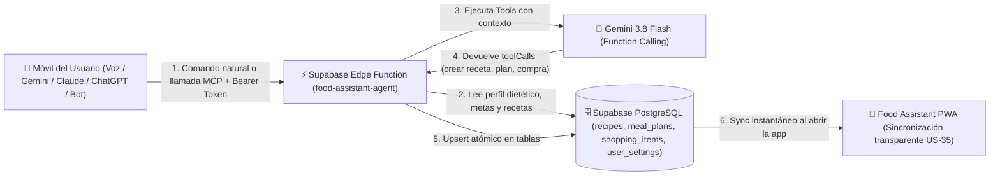

# 🌐 Plan Detallado — Fase 3: Agente Externo "Sin Abrir la App" (Headless AI API, MCP & Voz Móvil)

> **Historia cubierta**: `US-69` (🔴 Alta) — *Agente IA Externo "Sin Abrir la App" (Headless AI API, Servidor MCP y Supabase Edge Function para Gemini / Voz Móvil / Bots)*  
> **Objetivo**: Permitir al usuario invocar a Gemini (o cualquier IA: Claude, ChatGPT, Atajo de Voz de Android/iOS o Bot de Telegram/WhatsApp) **desde su móvil sin necesidad de abrir Food Assistant**, de modo que la IA lea sus recetas y preferencias dietéticas directamente en Supabase, cree recetas nuevas si hace falta, genere el Plan Semanal y actualice la Lista de la Compra en segundo plano.

---

## 1. Arquitectura General del Puente Externo

Gracias a `US-35`, todos los datos del usuario ya viven en **Supabase PostgreSQL** ([`replica/schema.sql`](../replica/schema.sql)):
- `public.recipes`
- `public.meal_plans`
- `public.shopping_items`
- `public.user_settings` (`dietary_preferences`, `custom_tags`, `nutrition_goals`)

Para que un asistente externo opere sobre estos datos de forma segura sin exponer la sesión del navegador, implementaremos:



---

## 2. Paso a Paso de Implementación

### Paso 3.1: Ampliar `replica/schema.sql` para Tokens de Agente Externo (`agent_api_key`)

Añadir en [`replica/schema.sql`](../replica/schema.sql) soporte idempotente en `public.user_settings` para almacenar el hash del token de agente personal del usuario (y opcionalmente su clave cifrada/configurada para llamadas headless):

```sql
alter table public.user_settings add column if not exists agent_token_hash text default null;
alter table public.user_settings add column if not exists agent_enabled boolean not null default false;
alter table public.user_settings add column if not exists default_servings integer not null default 2;
```

- **Seguridad del Token**:
  - En la app (`app.js`), cuando el usuario pulsa **"Generar Token de Conexión IA"** en Ajustes, se genera un token aleatorio criptográfico `fa_live_<UUIDsinGuiones>` con `crypto.randomUUID()`.
  - El token completo solo se muestra al usuario para copiarlo a su móvil/asistente, mientras que en Supabase (`user_settings.agent_token_hash`) se guarda su hash SHA-256 (`crypto.subtle.digest('SHA-256', ...)`).
  - Así, ni siquiera leyendo la base de datos en texto plano se puede reconstruir el token original si se revoca.

---

### Paso 3.2: Crear la Supabase Edge Function (`supabase/functions/food-assistant-agent/index.ts`)

Crear el directorio `supabase/functions/food-assistant-agent/index.ts` con soporte para **2 modos de invocación en un mismo endpoint**:

#### Modo 1: Comando Directo por Voz / Texto (`POST /functions/v1/food-assistant-agent`)
Pensado para **Atajos de Voz del móvil (Android Action Blocks / HTTP Shortcuts / iOS Shortcuts)**, **Gems / Scripts de Gemini** o **Bots de Telegram/WhatsApp**:
- **Entrada JSON**:
  ```json
  {
    "command": "Créame el menú semanal en Food Assistant alto en proteínas y añade aguacates y leche a la lista de la compra",
    "geminiApiKey": "opcional-si-no-esta-en-env-de-supabase"
  }
  ```
- **Flujo interno de la Edge Function**:
  1. Valida el header `Authorization: Bearer fa_live_...` calculando su SHA-256 y buscando el `user_id` en `public.user_settings` donde `agent_enabled = true`.
  2. Descarga en paralelo con `Promise.all`:
     - `user_settings` (`dietary_preferences`, `nutrition_goals`, `default_servings`)
     - `recipes` del `user_id`
     - `meal_plans` de los 7 días de la semana actual (calculada en ISO 8601 Lunes-Domingo)
     - `shopping_items` pendientes (`is_checked = false`)
  3. Construye el mismo prompt de sistema (`buildAiSystemInstruction`) y las mismas declaraciones `AI_TOOLS_DECLARATIONS` creadas en la **Fase 1** (`create_and_save_recipe`, `set_weekly_plan`, `manage_shopping_list`).
  4. Invoca a Gemini (`gemini-3.8-flash`) con `x-goog-api-key`.
  5. Ejecuta todas las `functionCalls` directamente contra Supabase mediante `.upsert()` en `public.recipes`, `public.meal_plans` y `public.shopping_items` con `updated_at: new Date().toISOString()`.
  6. Devuelve un JSON pensado para ser leído en voz alta por el asistente del móvil:
     ```json
     {
       "ok": true,
       "speech": "He creado tu menú semanal de lunes a domingo respetando tus preferencias, he añadido una receta nueva y he apuntado aguacates y leche en tu lista de la compra.",
       "actionsExecuted": [
         { "tool": "set_weekly_plan", "daysUpdated": 7 },
         { "tool": "manage_shopping_list", "itemsAdded": 2 }
       ]
     }
     ```

#### Modo 2: Servidor MCP (Model Context Protocol) y OpenAPI Actions (`/mcp` y `/openapi.json`)
Pensado para que el usuario conecte su cuenta directamente en **Claude (iOS/Android/Desktop vía MCP)**, **ChatGPT (Custom GPT Actions)** o **clientes MCP de Gemini**:
- `GET /functions/v1/food-assistant-agent/openapi.json`: Devuelve la especificación OpenAPI 3.1 lista para importar en 1 clic en cualquier plataforma de agentes IA.
- `POST /functions/v1/food-assistant-agent/mcp`: Responde a los métodos estándar de MCP (`tools/list` y `tools/call`) exponiendo:
  - `get_food_assistant_context`: Devuelve recetas, preferencias dietéticas, metas nutricionales, plan semanal actual y lista de la compra.
  - `create_and_save_recipe`: Inserta una receta nueva en `public.recipes`.
  - `set_weekly_plan`: Actualiza `public.meal_plans` para cualquier fecha `YYYY-MM-DD`.
  - `manage_shopping_list`: Añade, tacha o borra artículos en `public.shopping_items`.

---

### Paso 3.3: Panel "Conexión Externa (Voz Móvil / Gemini / MCP)" en Ajustes (`index.html` y `app.js`)

1. **Añadir tarjeta en `#view-settings` (`index.html`)**:
   - Título: **`📲 Control Externo por Voz e IA (Sin abrir la App)`**.
   - Controles:
     - Switch Material 3: **Activar acceso para asistentes externos (`agent_enabled`)**.
     - Campo de solo lectura con el **Token de Conexión Personal (`fa_live_...`)** + botón **"Generar / Regenerar Token"** + botón **"Copiar"**.
     - Botón **"📖 Guía rápida: Invocar desde el móvil (Gemini / Voz / MCP)"** que abre un modal `<dialog id="modal-external-ai-setup">` con 3 pestañas listas para copiar y pegar:
       1. **Atajo de Voz en Móvil (Android / iOS)**: Cómo crear en 30 segundos un comando de voz ("Crear menú semanal") que pida dictado por voz, llame al endpoint y lea la respuesta en voz alta.
       2. **Gemini / Google AI / Bot de Telegram**: Cómo vincular el comando directo.
       3. **Claude MCP / ChatGPT Actions**: URL del servidor MCP y esquema OpenAPI para pegarlo en su configuración.

---

### Paso 3.4: Sincronización Reactiva al Volver a la App (`visibilitychange` + Pull Inteligente)

1. **En `app.js` (`initEventListeners` / ciclo de vida de sincronización)**:
   - Añadir un listener a `document.addEventListener('visibilitychange', ...)` y `window.addEventListener('focus', ...)`:
     - Si `document.visibilityState === 'visible'` y el usuario tiene sesión activa en Supabase (`state.cloudUser?.id`), ejecutar un `this.syncDataWithCloud(true)` silencioso (con debounce de 15 segundos para no saturar).
   - De este modo, si el usuario tiene la app minimizada en el móvil, invoca a la IA por voz desde fuera y luego abre la app, el nuevo menú semanal, las recetas creadas por la IA y la lista de la compra aparecen al instante en pantalla sin tener que recargar manualmente.

---

## 3. Plan de Pruebas y Criterios de Cierre (CI = Verde)

1. **Tests en `tests/unit.test.js` y `test.html`**:
   - **Test `US-69` (Generación y Hash de Token de Agente)**: Verificar que `generateExternalAgentToken()` crea un token con prefijo `fa_live_`, guarda su hash en `state.settings` y lo sincroniza con `user_settings` en Supabase.
   - **Test `US-69` (Procesador de Comandos Remotos / MCP Handler)**: Extraer la lógica pura de despacho de herramientas (`dispatchHeadlessAgentAction`) para que sea testeable tanto en Vitest como en la Edge Function, verificando que una llamada externa con `set_weekly_plan` + `manage_shopping_list` actualiza el estado y devuelve el resumen hablado (`speech`).
   - **Test `US-69` (Auto-Sync en `visibilitychange`)**: Verificar que al cambiar a visible tras una mutación externa simulada en Supabase, la app descarga y pinta el nuevo plan semanal y los nuevos artículos de compra.
2. **Incrementar versión**: Subir versión en todos los archivos según `AGENTS.md` y comprobar que `CI & Quality Gate` finaliza en `success`.

