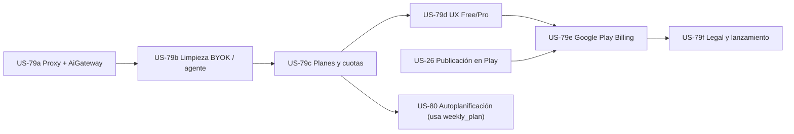

# 💎 Plan Detallado — US-79: Gobernanza de IA, Cuotas y Modelo Sabory Free / Pro

> **Historias cubiertas**: `US-79a` → `US-79f` (hijas de la épica `US-79`).
> **Objetivo**: que toda la IA pase por un servidor propio (Supabase Edge Function) con la clave de Gemini oculta, eliminar BYOK y el agente externo, y montar el modelo **Sabory Free / Sabory Pro** con cuotas, Pro compartido por hogar y suscripción con **Google Play Billing**.
> **Estado del código de referencia**: `v1.93` (las líneas citadas son orientativas; búscalas por nombre de función o id si se han movido).

---

## 0. Reglas para el agente que implemente estas historias

1. **Lee `AGENTS.md` antes de empezar.** Explica a Franky qué vas a hacer y **espera su OK** antes de tocar código.
2. **Una historia cada vez, en orden**: `79a → 79b → 79c → 79d → 79e → 79f`. No adelantes trabajo de la siguiente.
3. Al empezar una historia: pásala a `In Progress` en `BACKLOG.md` (por terminal) y haz commit y push.
4. Al terminar: sube la versión con `node scripts/bump-version.mjs <siguiente>` (ej. `1.94`), ejecuta `npm test`, haz commit y push a `main` y **verifica que el workflow `CI & Quality Gate` termina en `success`** (`gh run list --limit 1`, `gh run watch`). Si falla, lee el log de Vitest y corrige.
5. La historia queda en `In Progress` hasta que Franky la pruebe y la apruebe.
6. Todo texto visible al usuario va por i18n (`i18n.js`, claves en **`es` y `en`**). Nunca hardcodees textos nuevos en el HTML sin `data-i18n`.
7. Los cambios de base de datos se añaden **de forma idempotente** (`if not exists`, `drop policy if exists`, …) al final de [`replica/schema.sql`](../replica/schema.sql), como nueva sección numerada. Además se guarda una copia lista para pegar en `supabase/sql/<historia>.sql`. **Franky ejecuta ese SQL a mano** en el SQL Editor de Supabase: indícaselo al terminar.
8. Los despliegues de Edge Functions y los secretos también los hace Franky: deja los comandos exactos en tu mensaje final.
9. La lógica pura de las Edge Functions va en un `core.js` (JavaScript ESM sin dependencias de Deno) para poder testearla con Vitest, igual que hacía `supabase/functions/food-assistant-agent/core.js`.

---

## 1. Decisiones de producto (cerradas con Franky)

| # | Decisión |
| :--- | :--- |
| D1 | Modo Familia (US-77) es **solo Pro**. |
| D2 | Usuarios **sin cuenta → sin IA** (se les invita a iniciar sesión). |
| D3 | Chat libre y voz con el Sous Chef → **solo Pro**. |
| D4 | **Se elimina BYOK** (clave propia, proveedores OpenAI/Claude y selector de modelo). |
| D5 | Pagos solo con **Google Play Billing** (Digital Goods API en la TWA). En la web: *"Hazte Pro desde la app Android"*. Pro disponible desde el lanzamiento; Pro regalado a testers. |
| D6 | **Se elimina el agente externo** (US-69: MCP, tokens `fa_live_`, Edge Function `food-assistant-agent`). |
| D7 | Importar **sin IA** (URL con parser clásico, texto con formato de receta) → Free ilimitado. Importar **con IA** (foto, redes, generador, IA de respaldo cuando falla el parser) → Pro, con **3/mes** en Free. |
| D8 | **Un Pro cubre a todo el hogar**: si el **titular** (`households.owner_id`) tiene Pro activo, todos los miembros son Pro. |
| D9 | Prueba gratis de Pro de **14 días** (configurada en Play Console, solo para nuevos suscriptores). |

### Matriz de funcionalidades

| Feature (`feature` en el proxy) | Sin cuenta | Free | Pro |
| :--- | :---: | :---: | :---: |
| Uso manual (recetas, plan, lista, libros) | ✅ | ✅ | ✅ |
| `weekly_plan` — Autoplanificación semanal | — | 1 / semana ISO | Ilimitada* |
| `guided_query` — Chips del Sous Chef, IA de la nevera | — | 3 / día | Ilimitada* |
| `import_ai` — Foto, redes, generador, IA de respaldo del importador | — | 3 / mes | Ilimitada* |
| `chat` — Texto libre al Sous Chef | — | ❌ | Ilimitada* |
| `voice` — Micrófono del Sous Chef | — | ❌ | Ilimitada* |
| Modo Familia | — | ❌ | ✅ (todo el hogar) |

\* Tope técnico invisible de **200 llamadas/día por usuario** (suma de todas las features) para evitar abusos.

**Modelos** (los elige el servidor, nunca el cliente):
- Free → `['gemini-3.5-flash-lite', 'gemini-3.1-flash-lite']`
- Pro → `['gemini-3.8-flash', 'gemini-3.5-flash-lite']`

Los periodos se calculan en zona horaria `Europe/Madrid`: día natural, semana ISO (de lunes a domingo) y mes natural.

---

## 2. Mapa del código actual (lo que se toca)

| Elemento | Ubicación | Notas |
| :--- | :--- | :--- |
| Llamada principal a Gemini | `callGeminiAgent(prompt, systemInstruction, enableTools)` en `app.js` (~L15570) | `fetch` directo a `generativelanguage.googleapis.com` con bucle de modelos y fallback a `simulateGeminiAgentResponse` si hay saturación |
| Wrapper sin tools | `callGeminiApi` (~L15722) | llama a `callGeminiAgent(..., false)` |
| Proveedores BYOK | `callOpenAiAgent` (~L15838), `callClaudeAgent` (~L15884) | a eliminar |
| Resolución de clave | `getEffectiveGeminiApiKey` (~L15560) | clave propia → `household.sharedGeminiApiKey` → `settings.defaultGeminiApiKey` |
| Importador IA | `extractRecipeWithGemini({ text, imageBase64, mimeType, sourceUrl })` (~L17800) | segundo `fetch` directo a Gemini. Llamado desde el modo foto/IA (~L18138), la IA de respaldo de URL (~L18260) y la de texto (~L18284) |
| Chat de la vista IA | `handleAiChatSubmit(fromVoice)` (~L16806) | llama a `callGeminiAgent` |
| Sheet del Sous Chef | `handleGeminiInvokeSubmit(isVoice)` (~L17235) | llama a `callGeminiAgent`. Chips `#gemini-invoke-chips .gemini-chip` con `data-prompt` (~L8337) |
| Autoplanificación | `triggerGeminiAutoPlan()` (~L17504) | rellena `#ai-chat-input` y llama a `handleAiChatSubmit()` |
| Nevera | `generateRecipeFromFridgeWithAi()` (~L10416) | rellena el chat y llama a `handleAiChatSubmit()` |
| Fuga de clave (subida) | sync en `app.js` ~L7631-7642 | `upsert` de `app_config.default_gemini_api_key` con la clave personal |
| Fuga de clave (lectura) | sync en `app.js` ~L7082-7095 | lee `app_config` y la guarda en `settings.defaultGeminiApiKey` |
| Clave del hogar | ~L6916-6930 (lectura) y ~L7472-7485 (escritura `hhPrefSlotPayload.sharedGeminiApiKey`) | a eliminar |
| Clave en el perfil remoto | `user_settings.gemini_api_key`, `user_metadata.gemini_api_key` (~L6821-6940, ~L7074, ~L7583) | a eliminar |
| Ajustes de IA (HTML) | `index.html` `#card-ai-settings` (~L877-932): `#select-ai-provider`, `#wrapper-gemini-model`, `#select-gemini-model`, `#input-gemini-key`, `#btn-save-gemini-key`, `#gemini-key-status` | a eliminar |
| Ajustes de IA (JS) | `renderSettings()` (~L18412-18470), `saveGeminiKey()` (~L19897), listener `#btn-save-gemini-key` (~L8221) | a eliminar |
| Defaults de settings | constructor de estado (~L2500-2516): `geminiApiKey`, `geminiModel`, migración de modelos | a eliminar |
| Agente externo (HTML) | `index.html` `#card-external-agent` (~L934-990) | a eliminar |
| Agente externo (JS) | `getExternalAgentEndpoint`, `hashAgentToken`, `generateExternalAgentToken`, `revokeExternalAgentToken`, `copyExternalAgentText`, render del estado (~L19586-19700); listeners (~L8222-8224); sync `agent_token_hash` (~L6840, ~L7616); borrado de cuenta `external_agent_tokens` (~L6258) | a eliminar |
| Edge Function del agente | `supabase/functions/food-assistant-agent/` | a eliminar |
| Esquema | `replica/schema.sql` §5 (agente), §6 (hogar), §7 (`app_config` con insert/update abiertos a cualquier usuario autenticado) | |
| Config | `config.js` → `window.APP_CONFIG.supabaseUrl`, `supabaseAnonKey` | |
| Sesión | `state.cloudUser`, `this.supabaseClient`, `openAuthModal()` (~L6083) | |
| Versión | `scripts/bump-version.mjs` (actualiza `package.json`, `app.js`, `sw.js`, `index.html` y `tests/modals.test.js`) | |
| Tests afectados | `tests/ai.test.js`, `voice.test.js`, `importer.test.js`, `agent.test.js`, `family-mode.test.js` (~L517-560), `i18n.test.js` (~L565-575), `legal-privacy.test.js` (~L163), `ux-identity.test.js` (~L175) | |

---

## 3. US-79a — Proxy de IA seguro en Supabase (`ai-proxy`) + `AiGateway` en la app

**Objetivo**: que la app no vuelva a llamar a Gemini directamente. Todas las llamadas pasan por la Edge Function `ai-proxy`, que exige sesión, usa la clave guardada en los secretos del servidor y registra el uso. En esta historia **todavía no hay cuotas**: todo usuario con sesión se trata como `pro`, y los usuarios sin sesión no tienen IA.

### 3.1 Base de datos (`replica/schema.sql` §9 y `supabase/sql/us79a.sql`)

```sql
-- 9. REGISTRO DE USO DE IA (US-79a)
create table if not exists public.ai_usage (
  id bigint generated always as identity primary key,
  user_id uuid not null references auth.users(id) on delete cascade,
  feature text not null check (feature in ('chat','voice','guided_query','weekly_plan','import_ai')),
  model text not null default '',
  prompt_tokens integer not null default 0,
  output_tokens integer not null default 0,
  status text not null default 'pending' check (status in ('pending','ok','error')),
  created_at timestamptz not null default now()
);
create index if not exists ai_usage_user_feature_created_idx on public.ai_usage (user_id, feature, created_at desc);
alter table public.ai_usage enable row level security;
drop policy if exists "Users read own ai_usage" on public.ai_usage;
create policy "Users read own ai_usage" on public.ai_usage for select using (auth.uid() = user_id);
-- Sin políticas de insert/update/delete: solo escribe la Edge Function con service_role.
```

**No se guardan prompts ni respuestas**, solo contadores (privacidad).

### 3.2 Edge Function `supabase/functions/ai-proxy/`

**`core.js`** (ESM puro, testeable):

```js
export const AI_FEATURES = ['chat', 'voice', 'guided_query', 'weekly_plan', 'import_ai'];
export const MAX_PAYLOAD_BYTES = 4 * 1024 * 1024; // imágenes ya comprimidas a 1024px en cliente
export const MAX_OUTPUT_TOKENS = 8192;
export const MODEL_CHAINS = {
  free: ['gemini-3.5-flash-lite', 'gemini-3.1-flash-lite'],
  pro: ['gemini-3.8-flash', 'gemini-3.5-flash-lite']
};
export function resolveModelChain(plan) { return MODEL_CHAINS[plan === 'pro' ? 'pro' : 'free']; }
export function validateAiRequest(body, rawLength = 0) {
  // -> { ok: true } | { ok: false, status: 400|413, code: 'INVALID_FEATURE'|'INVALID_PAYLOAD'|'PAYLOAD_TOO_LARGE' }
  // feature debe estar en AI_FEATURES; payload.contents debe ser un array no vacío; rawLength <= MAX_PAYLOAD_BYTES
}
export function sanitizePayload(payload) {
  // Lista blanca: contents, systemInstruction, tools, toolConfig, generationConfig.
  // Descarta cualquier otra clave (model, key, safetySettings, cachedContent…).
  // generationConfig.maxOutputTokens = min(valor || MAX_OUTPUT_TOKENS, MAX_OUTPUT_TOKENS)
}
export function extractUsage(geminiData) {
  // -> { promptTokens: usageMetadata.promptTokenCount || 0, outputTokens: usageMetadata.candidatesTokenCount || 0 }
}
export function timeoutForModel(model) { return model === 'gemini-3.8-flash' ? 16000 : 20000; }
```

**`index.ts`** (Deno):
1. `OPTIONS` → 204 con CORS (`Access-Control-Allow-Origin: *`, headers `authorization, content-type, apikey, x-client-info`). Solo `POST`; si no → 405.
2. Auth: `createClient(SUPABASE_URL, SUPABASE_ANON_KEY, { global: { headers: { Authorization: req.headers.get('Authorization') } } })` → `auth.getUser()`. Sin usuario → `401 { ok:false, code:'AUTH_REQUIRED' }`.
3. Lee el body como texto y aplica `validateAiRequest(JSON.parse(text), text.length)` → 400/413.
4. `plan = 'pro'` (**provisional; en US-79c se sustituye por la RPC de cuotas**).
5. Cliente admin `createClient(SUPABASE_URL, SUPABASE_SERVICE_ROLE_KEY)`: `insert` en `ai_usage` (`status: 'pending'`, `feature`, `user_id`) → `usageId`.
6. Para cada modelo de `resolveModelChain(plan)`: `fetch('https://generativelanguage.googleapis.com/v1beta/models/${model}:generateContent', { method:'POST', headers: { 'Content-Type':'application/json', 'x-goog-api-key': Deno.env.get('GEMINI_API_KEY') }, body: JSON.stringify(sanitizePayload(payload)), signal })` con `AbortController` y `timeoutForModel`. Si devuelve 429/503/timeout, pasa al siguiente modelo.
7. Si hay éxito: `update ai_usage set status='ok', model, prompt_tokens, output_tokens` y responde `200 { ok:true, model, data: <respuesta cruda de Gemini>, quota: null }`.
8. Si todos fallan: `update status='error'` y responde `502 { ok:false, code:'UPSTREAM_ERROR', message }`. Las llamadas con error **no cuentan** para la cuota.
9. Nunca devolver ni registrar la clave. Nunca leer `model` del cliente.

**Despliegue (lo hace Franky)**:
```bash
supabase secrets set GEMINI_API_KEY=<clave de un proyecto AI Studio con facturación pay-as-you-go>
supabase functions deploy ai-proxy        # con verificación JWT (por defecto)
```

### 3.3 Cliente (`app.js`)

1. **Nuevos métodos** en `FoodAssistantApp`:
   - `getAiProxyEndpoint()` → `${APP_CONFIG.supabaseUrl (o localStorage fa_sb_url) sin barra final}/functions/v1/ai-proxy`, o `''`.
   - `async getAiAuthToken()` → `(await this.supabaseClient?.auth?.getSession())?.data?.session?.access_token || null`. Es un método aparte para poder mockearlo en tests.
   - `async invokeAiProxy(feature, payload)`:
     - si `!state.cloudUser` o no hay token → `return { ok:false, code:'AUTH_REQUIRED' }` **sin hacer fetch**;
     - si no, `fetch(endpoint, { method:'POST', headers: { 'Content-Type':'application/json', 'Authorization': 'Bearer ' + token, 'apikey': APP_CONFIG.supabaseAnonKey }, body: JSON.stringify({ feature, payload }) })` con timeout de 45 s;
     - devuelve `{ ok, status, ...json }`. Un error de red → `{ ok:false, code:'NETWORK_ERROR' }`.
2. **Refactor de `callGeminiAgent(prompt, systemInstruction = "", enableTools = true, options = {})`**:
   - elimina la redirección a OpenAI/Claude y el uso de `getEffectiveGeminiApiKey`;
   - elimina el bucle de modelos y la migración `geminiModel`;
   - mantiene la construcción de `payload` (historial, `systemInstruction`, `tools` + `toolConfig`) y llama a `const res = await this.invokeAiProxy(options.feature || 'chat', payload)`;
   - `res.code === 'AUTH_REQUIRED'` → `return { text: I18n.t('ai.loginRequired'), requiresLogin: true, functionCalls: [] }`;
   - `res.status === 402 || res.status === 403 || res.status === 429` → `return { text: I18n.t('ai.quotaExceeded'), quotaExceeded: true, code: res.code, quota: res.quota, functionCalls: [] }` (la UI bonita llega en US-79d);
   - `UPSTREAM_ERROR` / `NETWORK_ERROR` → mantiene el comportamiento actual: `{ ...this.simulateGeminiAgentResponse(prompt), isSimulatedFallback: true, originalError }`;
   - si va bien → parsea `res.data` **con el mismo código de hoy** (`data.candidates?.[0]?.content?.parts`…).
   - Si `res.quota` existe, guárdalo en `this.lastAiQuota = res.quota` (lo usará US-79c/d).
3. **`callGeminiApi(prompt, systemInstruction = "", options = {})`** → reenvía `options`.
4. **`extractRecipeWithGemini`**: mantiene la construcción de `parts` (texto + `inlineData`) y de `generationConfig`, sustituye el bucle `fetch` por `invokeAiProxy('import_ai', { contents: [{ role:'user', parts }], generationConfig })` y trata `requiresLogin`/`quotaExceeded` lanzando un `Error` con `code` para que el modal de importación muestre el mensaje.
5. **Propagación de `feature`**: añade un parámetro `options = {}` a `handleAiChatSubmit(fromVoice = false, options = {})` y `handleGeminiInvokeSubmit(isVoice = false, options = {})`, y pásalo a `callGeminiAgent(..., { feature })`. Regla por defecto: `options.feature || (fromVoice/isVoice ? 'voice' : 'chat')`.
   - `triggerGeminiAutoPlan()` → `handleAiChatSubmit(false, { feature: 'weekly_plan' })`
   - `triggerCreateMissingSlotRecipes()` → `{ feature: 'guided_query' }`
   - `generateRecipeFromFridgeWithAi()` → `{ feature: 'guided_query' }` (en sus dos ramas)
   - click en `#gemini-invoke-chips .gemini-chip` → `handleGeminiInvokeSubmit(false, { feature: 'guided_query' })`
   - texto escrito → `'chat'`; micrófono → `'voice'`.
6. **UI mínima de `requiresLogin`**: en ambos submits, si la respuesta trae `requiresLogin`, muestra el texto en el hilo y llama a `this.openAuthModal()`.
7. **i18n** (`es` / `en`): `ai.loginRequired` ("Inicia sesión para usar el Sous Chef" / "Sign in to use the Sous Chef") y `ai.quotaExceeded` ("Has alcanzado tu límite de IA" / "You've reached your AI limit").

### 3.4 Tests US-79a

**Nuevo `tests/ai-proxy.test.js`** (importa `../supabase/functions/ai-proxy/core.js`):
- `validateAiRequest`: rechaza un `feature` desconocido (`INVALID_FEATURE`), `contents` vacío o ausente (`INVALID_PAYLOAD`) y un tamaño mayor que `MAX_PAYLOAD_BYTES` (`PAYLOAD_TOO_LARGE`, 413); acepta una petición válida de cada uno de los 5 features.
- `resolveModelChain('free')[0] === 'gemini-3.5-flash-lite'`, `resolveModelChain('pro')[0] === 'gemini-3.8-flash'`, y un plan desconocido equivale a free.
- `sanitizePayload` elimina `model`, `key` y `safetySettings`; conserva `contents`, `systemInstruction`, `tools` y `toolConfig`; limita `maxOutputTokens: 999999` a 8192.
- `extractUsage` lee `usageMetadata` y devuelve 0 si falta.
- Estático: `supabase/functions/ai-proxy/index.ts` contiene `Deno.env.get('GEMINI_API_KEY')` y **no** contiene `AIza`.

**En `tests/ai.test.js`** (nuevo `describe('US-79a: AiGateway')`), con `state.cloudUser = { id:'u1', email:'a@b.c' }`, `appInstance.getAiAuthToken = vi.fn().mockResolvedValue('tok')` y `globalThis.fetch` mockeado:
- `callGeminiAgent('hola')` hace fetch a una URL que termina en `/functions/v1/ai-proxy`, con `method: 'POST'`, `Authorization: 'Bearer tok'`, `body.feature === 'chat'` y el último `contents` con texto `'hola'`; **sin** cabecera `x-goog-api-key`.
- Una respuesta 200 con `data.candidates[0].content.parts[0].text = 'ok'` devuelve `text === 'ok'`.
- Sin `state.cloudUser`: devuelve `requiresLogin: true` y `fetch` **no** se llama.
- Una respuesta 402 devuelve `quotaExceeded: true`.
- Una respuesta 502 devuelve `isSimulatedFallback: true`.
- `triggerGeminiAutoPlan()` → `body.feature === 'weekly_plan'`; `generateRecipeFromFridgeWithAi()` → `'guided_query'`; click en un chip → `'guided_query'`; `handleGeminiInvokeSubmit(true)` → `'voice'`.
- `extractRecipeWithGemini({ imageBase64:'xx' })` → `body.feature === 'import_ai'` y `parts` incluye `inlineData`.
- Estático: `app.js` **no** contiene `generativelanguage.googleapis.com`.

**Adaptar los tests existentes** que mockean fetch esperando la URL de Gemini (`ai.test.js`, `voice.test.js`, `importer.test.js`): cambia la URL esperada por la del proxy, añade `cloudUser` y el mock de `getAiAuthToken`, y envuelve la respuesta de Gemini en `{ ok:true, data: <respuesta> }`. **Elimina** los tests de migración o selección de modelo en cliente (p. ej. "v0.78: Modelos obsoletos…" y los de fallback entre modelos), porque ahora lo decide el servidor. Indica en el commit qué tests se han eliminado y por qué.

### 3.5 DoD US-79a
- [ ] La suite de Vitest está verde en CI.
- [ ] `app.js` no llama a Gemini directamente.
- [ ] Franky ha ejecutado `us79a.sql`, ha configurado el secreto y ha desplegado `ai-proxy`.
- [ ] Prueba manual: con sesión, el chat, los chips, la nevera, la autoplanificación y el escaneo por foto funcionan y aparecen filas `ok` en `ai_usage` con el `feature` correcto. Sin sesión, se abre el login.

---

## 4. US-79b — Limpieza: fuera BYOK, clave compartida, `app_config` y agente externo

**Objetivo**: eliminar todo el código que queda sin uso tras US-79a y cerrar definitivamente la fuga de claves.

### 4.1 Eliminar en `index.html`
- Toda la tarjeta `#card-ai-settings` (proveedor, modelo, clave y estado).
- Toda la tarjeta `#card-external-agent`.
- Si el acordeón de ajustes avanzados queda vacío, elimínalo también o deja solo lo que siga teniendo contenido.

### 4.2 Eliminar en `app.js`
- Métodos: `getEffectiveGeminiApiKey`, `callOpenAiAgent`, `callClaudeAgent`, `saveGeminiKey`, `getExternalAgentEndpoint`, `hashAgentToken`, `generateExternalAgentToken`, `revokeExternalAgentToken`, `copyExternalAgentText`, el render del estado del agente externo y el código de `renderSettings()` que pinta proveedor, modelo o clave.
- Listeners: `#btn-save-gemini-key`, `#btn-generate-agent-token`, `#btn-revoke-agent-token`, `#btn-copy-agent-token`, `#select-ai-provider` y `#select-gemini-model`.
- Defaults de estado: `geminiApiKey`, `geminiModel`, `aiProvider` y la migración de modelos (~L2500-2516).
- Sincronización:
  - lectura y escritura de `gemini_api_key` (fila `user_settings` y `user_metadata`);
  - `remoteGeminiKey`;
  - `sharedGeminiApiKey` del hogar (lectura en `__household_prefs__` y escritura en `hhPrefSlotPayload`);
  - todo el bloque de `app_config` (lectura y `upsert`);
  - `agent_token_hash` / `agentTokenHash` / `agentTokenHint`.
- Borrado de cuenta: quita `external_agent_tokens` de la lista de tablas.
- **Migración de limpieza local**: donde hoy se borra `state.settings.defaultGeminiApiKey` (~L6222), borra también `geminiApiKey`, `geminiModel`, `aiProvider`, `defaultGeminiApiKey`, `agentTokenHash` y `agentTokenHint`, y guarda `fa_settings`. Si `state.household` tiene `sharedGeminiApiKey`, bórralo también.
- **Limpieza remota única**: tras el login, si `state.cloudUser.user_metadata?.gemini_api_key` existe, llama a `this.supabaseClient.auth.updateUser({ data: { gemini_api_key: null } })`.

### 4.3 Eliminar en el resto del repo
- La carpeta `supabase/functions/food-assistant-agent/` y `tests/agent.test.js`.
- `plans/FASE-3-AGENTE-HEADLESS-MCP.md`: añade arriba `> ⚠️ Retirado en US-79b (v1.9x): el agente externo se eliminó. Se conserva como histórico.`
- Las claves i18n que ya no se usan, en `es` y `en`: opciones de proveedor y modelo, clave de API, `generateToken`, `revokeToken` y todo lo del agente externo. Comprueba con `grep` que ninguna clave borrada sigue referenciada.

### 4.4 Base de datos (`replica/schema.sql` §10 y `supabase/sql/us79b.sql`)

```sql
-- 10. LIMPIEZA BYOK / AGENTE EXTERNO (US-79b)
drop table if exists public.app_config;
drop table if exists public.external_agent_tokens;
drop index if exists public.user_settings_agent_token_hash_idx;
alter table public.user_settings drop column if exists agent_token_hash;
alter table public.user_settings drop column if exists agent_enabled;
alter table public.user_settings drop column if exists gemini_api_key;
```

Y en el propio `schema.sql`, **borra o comenta** la sección §7 (`app_config`) y las líneas del agente de la §5, para que una instalación nueva no las vuelva a crear.

### 4.5 Pasos manuales de Franky
1. Ejecutar `us79b.sql`.
2. `supabase functions delete food-assistant-agent`.
3. **Cambiar la clave**: crear una clave nueva en Google AI Studio (proyecto con facturación), ejecutar `supabase secrets set GEMINI_API_KEY=<nueva>` y **eliminar la clave antigua** en AI Studio, porque ha estado expuesta en el cliente.

### 4.6 Tests US-79b
**Nuevo `tests/ai-cleanup.test.js`**:
- Estático en `index.html`: no existen `select-ai-provider`, `select-gemini-model`, `input-gemini-key`, `btn-save-gemini-key`, `card-external-agent` ni `external-agent-token`.
- Estático en `app.js`: no contiene `callOpenAiAgent`, `callClaudeAgent`, `getEffectiveGeminiApiKey`, `sharedGeminiApiKey`, `app_config`, `external_agent_tokens`, `fa_live_` ni `food-assistant-agent`.
- `fs.existsSync('supabase/functions/food-assistant-agent')` es `false`.
- Migración: con `localStorage.fa_settings = { geminiApiKey:'AIzaX', aiProvider:'openai', geminiModel:'x', defaultGeminiApiKey:'AIzaY', agentTokenHash:'h', defaultServings:3 }`, tras inicializar el estado esas claves desaparecen y se mantiene `defaultServings: 3`.
- Sincronización (con el patrón de mock de Supabase de `tests/sync.test.js` / `family-mode.test.js`): tras `syncToCloud` no se llama a `from('app_config')`; la fila de `user_settings` no tiene `gemini_api_key` ni `agent_token_hash`; el payload de `__household_prefs__` no tiene `sharedGeminiApiKey`.
- i18n: ninguna clave de `es` falta en `en` ni al revés (si ya existe un test de paridad, debe seguir verde).

**Adaptar tests existentes**:
- `family-mode.test.js` ~L517-560: elimina los tests de `app_config` y de la clave personal.
- `legal-privacy.test.js` ~L163: deja de esperar `external_agent_tokens`.
- `i18n.test.js` ~L565-575: elimina las partes del agente externo.
- `ux-identity.test.js` ~L175: elimina la expectativa de `#card-external-agent`.
- `ai.test.js`: elimina `geminiApiKey` y `geminiModel` de los `beforeEach`.

### 4.7 DoD US-79b
- [ ] CI verde.
- [ ] Ajustes sin ninguna referencia a claves, proveedores ni agente externo.
- [ ] La clave antigua está eliminada en AI Studio y la IA sigue funcionando con la nueva.

---

## 5. US-79c — Planes, cuotas y Pro compartido por hogar

**Objetivo**: el servidor decide si el usuario es Free o Pro, aplica las cuotas de la matriz (§1) y elige el modelo. Además, el Modo Familia queda reservado a Pro. Los testers reciben Pro regalado.

### 5.1 Base de datos (`replica/schema.sql` §11 y `supabase/sql/us79c.sql`)

```sql
-- 11. PLANES Y CUOTAS (US-79c)
create table if not exists public.entitlements (
  user_id uuid primary key references auth.users(id) on delete cascade,
  plan text not null default 'free' check (plan in ('free','pro')),
  source text not null default 'none' check (source in ('none','play','gift','admin')),
  status text not null default 'active' check (status in ('active','grace','on_hold','canceled','expired')),
  period_end timestamptz,
  is_trial boolean not null default false,
  play_product_id text,
  play_purchase_token text unique,
  updated_at timestamptz not null default now()
);
alter table public.entitlements enable row level security;
drop policy if exists "Users read own entitlement" on public.entitlements;
create policy "Users read own entitlement" on public.entitlements for select using (auth.uid() = user_id);
-- Sin políticas de escritura: solo service_role (Edge Functions) y el SQL Editor.

-- ¿Tiene este usuario un Pro propio vigente?
create or replace function public.has_own_pro(p_user uuid) returns boolean
language sql stable security definer set search_path = public as $$
  select exists (
    select 1 from public.entitlements e
    where e.user_id = p_user and e.plan = 'pro'
      and e.status in ('active','grace','canceled')
      and (e.period_end is null or e.period_end > now())
  );
$$;

-- Plan efectivo: Pro propio, o miembro de un hogar cuyo titular tiene Pro (D8).
create or replace function public.effective_plan(p_user uuid) returns text
language sql stable security definer set search_path = public as $$
  select case
    when public.has_own_pro(p_user) then 'pro'
    when exists (
      select 1 from public.household_members hm
      join public.households h on h.id = hm.household_id
      where hm.user_id = p_user and public.has_own_pro(h.owner_id)
    ) then 'pro'
    else 'free'
  end;
$$;

-- Reserva atómica de cuota. La llama SOLO la Edge Function (service_role).
create or replace function public.consume_ai_quota(p_user uuid, p_feature text)
returns jsonb language plpgsql security definer set search_path = public as $$
declare
  v_plan text := public.effective_plan(p_user);
  v_now timestamptz := now();
  v_local timestamp := (v_now at time zone 'Europe/Madrid');
  v_limit int; v_period text; v_since timestamptz; v_used int; v_day_total int; v_id bigint;
begin
  perform pg_advisory_xact_lock(hashtext(p_user::text));
  -- Tope técnico diario (todas las features, ambos planes)
  select count(*) into v_day_total from public.ai_usage
   where user_id = p_user and status in ('pending','ok')
     and created_at >= (date_trunc('day', v_local) at time zone 'Europe/Madrid');
  if v_day_total >= 200 then
    return jsonb_build_object('allowed', false, 'code', 'RATE_LIMITED', 'plan', v_plan);
  end if;

  if v_plan = 'pro' then
    v_limit := null; v_period := 'day';
  else
    if p_feature in ('chat','voice') then
      return jsonb_build_object('allowed', false, 'code', 'PRO_REQUIRED', 'plan', v_plan, 'feature', p_feature);
    elsif p_feature = 'weekly_plan' then v_limit := 1; v_period := 'week';
    elsif p_feature = 'guided_query' then v_limit := 3; v_period := 'day';
    elsif p_feature = 'import_ai' then v_limit := 3; v_period := 'month';
    else
      return jsonb_build_object('allowed', false, 'code', 'INVALID_FEATURE');
    end if;
  end if;

  v_since := (date_trunc(v_period, v_local) at time zone 'Europe/Madrid'); -- 'week' = lunes ISO
  select count(*) into v_used from public.ai_usage
   where user_id = p_user and feature = p_feature and status in ('pending','ok') and created_at >= v_since;

  if v_limit is not null and v_used >= v_limit then
    return jsonb_build_object('allowed', false, 'code', 'QUOTA_EXCEEDED', 'plan', v_plan,
      'feature', p_feature, 'used', v_used, 'limit', v_limit, 'remaining', 0, 'period', v_period);
  end if;

  insert into public.ai_usage (user_id, feature, status) values (p_user, p_feature, 'pending') returning id into v_id;
  return jsonb_build_object('allowed', true, 'plan', v_plan, 'usage_id', v_id, 'feature', p_feature,
    'used', v_used + 1, 'limit', v_limit,
    'remaining', case when v_limit is null then null else v_limit - v_used - 1 end, 'period', v_period);
end; $$;

revoke execute on function public.consume_ai_quota(uuid, text) from public, anon, authenticated;
grant execute on function public.consume_ai_quota(uuid, text) to service_role;

-- Estado para pintar contadores en el cliente (solo lectura, usuario actual).
create or replace function public.get_ai_quota_status() returns jsonb
language plpgsql stable security definer set search_path = public as $$
declare
  v_user uuid := auth.uid();
  v_plan text; v_local timestamp := (now() at time zone 'Europe/Madrid');
  v_ent public.entitlements%rowtype;
  v_household_pro boolean := false;
  -- uso actual por feature en su periodo
  v_wp int; v_gq int; v_ia int;
begin
  if v_user is null then return jsonb_build_object('plan', 'anonymous'); end if;
  v_plan := public.effective_plan(v_user);
  select * into v_ent from public.entitlements where user_id = v_user;
  v_household_pro := (v_plan = 'pro' and not public.has_own_pro(v_user));
  select count(*) into v_wp from public.ai_usage where user_id = v_user and feature = 'weekly_plan' and status in ('pending','ok')
    and created_at >= (date_trunc('week', v_local) at time zone 'Europe/Madrid');
  select count(*) into v_gq from public.ai_usage where user_id = v_user and feature = 'guided_query' and status in ('pending','ok')
    and created_at >= (date_trunc('day', v_local) at time zone 'Europe/Madrid');
  select count(*) into v_ia from public.ai_usage where user_id = v_user and feature = 'import_ai' and status in ('pending','ok')
    and created_at >= (date_trunc('month', v_local) at time zone 'Europe/Madrid');
  return jsonb_build_object(
    'plan', v_plan,
    'source', coalesce(v_ent.source, 'none'),
    'status', v_ent.status,
    'period_end', v_ent.period_end,
    'is_trial', coalesce(v_ent.is_trial, false),
    'via_household', v_household_pro,
    'quotas', jsonb_build_object(
      'weekly_plan', jsonb_build_object('used', v_wp, 'limit', case when v_plan = 'pro' then null else 1 end, 'period', 'week'),
      'guided_query', jsonb_build_object('used', v_gq, 'limit', case when v_plan = 'pro' then null else 3 end, 'period', 'day'),
      'import_ai', jsonb_build_object('used', v_ia, 'limit', case when v_plan = 'pro' then null else 3 end, 'period', 'month'),
      'chat', jsonb_build_object('used', 0, 'limit', case when v_plan = 'pro' then null else 0 end, 'period', 'day'),
      'voice', jsonb_build_object('used', 0, 'limit', case when v_plan = 'pro' then null else 0 end, 'period', 'day')
    )
  );
end; $$;
grant execute on function public.get_ai_quota_status() to authenticated;
```

**Modo Familia solo Pro (RLS)**: en la §6 de `schema.sql`, localiza las políticas `insert` de `public.households` y `public.household_members` y sustitúyelas (`drop policy if exists` + `create policy`) añadiendo:
- en `households` (crear hogar): `with check (auth.uid() = owner_id and public.effective_plan(auth.uid()) = 'pro')`;
- en `household_members` (unirse): la condición existente **AND** `public.has_own_pro((select h.owner_id from public.households h where h.id = household_id))`.

Si el titular pierde Pro, **los datos del hogar no se borran** y siguen accesibles (no se toca `is_household_member`). El cliente pausa la colaboración (US-79d).

**Plantilla para regalar Pro** (`supabase/sql/grant-pro-gift.sql`, para que Franky la use desde el SQL Editor):
```sql
insert into public.entitlements (user_id, plan, source, status, period_end)
values ((select id from auth.users where email = 'AMIGO@EMAIL.COM'), 'pro', 'gift', 'active', now() + interval '90 days')
on conflict (user_id) do update set plan = 'pro', source = 'gift', status = 'active',
  period_end = excluded.period_end, updated_at = now();
-- Pro permanente (Franky y su mujer): period_end = null y source = 'admin'.
```

### 5.2 Edge Function `ai-proxy` (cambios)
- En `core.js`, añade `mapQuotaResult(rpc)` → `null` si `rpc.allowed`; si no, `{ status, body }` con `PRO_REQUIRED → 403`, `QUOTA_EXCEEDED → 402`, `RATE_LIMITED → 429` e `INVALID_FEATURE → 400`. `body = { ok:false, code, quota: { feature, used, limit, remaining, period, plan } }`.
- En `index.ts`, sustituye el `plan = 'pro'` provisional y el `insert` de `ai_usage` por `admin.rpc('consume_ai_quota', { p_user: user.id, p_feature: feature })`:
  - si `mapQuotaResult` devuelve algo, responde con eso **sin llamar a Gemini**;
  - si no, `plan = rpc.plan` y `usageId = rpc.usage_id`, y el resto queda igual;
  - en la respuesta 200 incluye `quota: { feature, used, limit, remaining, period, plan }`.

### 5.3 Cliente (`app.js`)
- `state.aiPlan = { plan: 'anonymous'|'free'|'pro', source, status, periodEnd, isTrial, viaHousehold, quotas, fetchedAt }` (en memoria; cachéalo en `localStorage fa_ai_plan` solo como pista visual).
- `async loadAiPlanStatus()` → `this.supabaseClient.rpc('get_ai_quota_status')`. Se llama tras el login, al volver la app a primer plano (`visibilitychange`), tras cambiar de hogar y tras una compra (US-79e). Sin sesión → `{ plan: 'anonymous' }`.
- `isPro()` → `state.aiPlan?.plan === 'pro'`.
- Tras cada respuesta del proxy con `quota`, actualiza `state.aiPlan.quotas[feature]`.
- **Gate de Modo Familia**: en los métodos de crear hogar (~L18682) y unirse (~L18799-18830), si `!this.isPro()` → `this.openPaywall('family')` (en esta historia basta un stub que muestre un toast `paywall.familyPro`; el modal real llega en US-79d) y `return` **antes** de cualquier llamada a Supabase. Si Supabase devuelve un error RLS (`42501`), haz lo mismo.

### 5.4 Tests US-79c
**Nuevo `tests/entitlements.test.js`**:
- Estático en `replica/schema.sql`:
  - contiene `create table if not exists public.entitlements` y `alter table public.entitlements enable row level security`;
  - **no** contiene `create policy` de `insert` ni de `update` sobre `public.entitlements`;
  - contiene `function public.effective_plan`, `function public.consume_ai_quota` y `security definer`;
  - contiene `revoke execute on function public.consume_ai_quota(uuid, text) from public, anon, authenticated`;
  - la política de insert de `households` contiene `effective_plan(auth.uid()) = 'pro'`;
  - existe `supabase/sql/grant-pro-gift.sql`.
- `mapQuotaResult` (desde `core.js`): `allowed → null`, `PRO_REQUIRED → 403`, `QUOTA_EXCEEDED → 402` con `remaining: 0`, `RATE_LIMITED → 429`.
- Cliente:
  - `loadAiPlanStatus()` con `supabaseClient.rpc` mockeado guarda `state.aiPlan.plan === 'free'` y las cuotas;
  - `isPro()` devuelve true/false según el plan;
  - una respuesta 200 del proxy con `quota.remaining = 1` actualiza `state.aiPlan.quotas.guided_query`;
  - crear hogar con plan free llama al stub de paywall y **no** llama a `from('households').insert`;
  - con plan pro, sí llama a `insert`.

**Verificación manual del SQL** (Franky, en el SQL Editor): incluye en `supabase/sql/us79c-checks.sql` consultas comentadas para (1) dar Pro a un usuario de prueba, (2) `select public.effective_plan('<uuid>')`, (3) llamar a `consume_ai_quota` 4 veces con `guided_query` en un usuario free (la 4.ª debe devolver `QUOTA_EXCEEDED`) y (4) borrar las filas de prueba de `ai_usage`.

### 5.5 DoD US-79c
- [ ] CI verde y SQL aplicado.
- [ ] Franky y su mujer con Pro `admin`.
- [ ] Un usuario free de prueba: la 4.ª consulta guiada del día es rechazada, el chat devuelve `PRO_REQUIRED` y no puede crear un hogar.
- [ ] Un miembro del hogar de un titular Pro aparece como `pro` (`via_household: true`).

---

## 6. US-79d — Experiencia Free / Pro en la app

**Objetivo**: que el usuario entienda su plan y sus límites, y que llegar a un límite lleve a una pantalla de Pro clara y no a un error.

### 6.1 Componentes nuevos (`index.html` + `styles.css`, siguiendo el design system Material 3 actual)
1. **Tarjeta "Tu plan"** en Ajustes `#card-plan`, en primera posición del grupo de cuenta:
   - `#plan-badge`: "Free" / "Pro" / "Pro · Prueba" / "Pro · Regalo" / "Pro · Hogar";
   - `#plan-detail`: "Se renueva el dd/mm", "Regalo hasta dd/mm" o "Incluido por el hogar de <titular>";
   - `#plan-quotas`: lista con barra de progreso para `weekly_plan`, `guided_query` e `import_ai` ("1/3 hoy", "0/1 esta semana", "2/3 este mes"), o "Ilimitado" en Pro;
   - botones: `#btn-plan-upgrade` ("Hazte Pro", visible si es free) y `#btn-plan-manage` ("Gestionar suscripción", visible si `source === 'play'`, abre `https://play.google.com/store/account/subscriptions?package=food.sabory.app`);
   - sin sesión: texto "Inicia sesión para usar la IA" y un botón que abre `openAuthModal()`.
2. **Modal de Pro** `<dialog id="modal-paywall">`:
   - título, lista de ventajas (menús ilimitados con el mejor modelo, chat y voz con el Sous Chef, escaneo ilimitado y Modo Familia para todo el hogar);
   - dos opciones `#btn-paywall-monthly` (2,99 €/mes) y `#btn-paywall-annual` (24,99 €/año, etiqueta "Ahorra 30 %"), y el texto "14 días gratis, cancela cuando quieras";
   - `#paywall-reason`: mensaje contextual según el motivo (`chat`, `voice`, `quota_guided_query`, `quota_weekly_plan`, `quota_import_ai`, `family`);
   - `#paywall-web-notice`: visible si no hay Play Billing (web): "Hazte Pro desde la app Android" + enlace a la ficha de Play.
   - Hasta US-79e los botones de compra muestran el aviso web.
3. **Contador en el sheet del Sous Chef** `#gemini-invoke-quota`, encima de los chips: en Free, "Te quedan X consultas hoy"; oculto en Pro.
4. **Candado en el input y el micrófono del Sous Chef** para Free: placeholder "El chat libre es Pro ✨". Al pulsar el input, enviar o tocar el micrófono, se abre el modal de Pro con motivo `chat`/`voice`. Los chips siguen disponibles.
5. **Badge en el botón de autoplanificar** (`#btn-planner-ai-auto`, `#btn-quick-ai-plan`): en Free, "1/semana" o "Usado esta semana".
6. **Pestaña Foto / IA del importador**: en Free, "X/3 este mes".
7. **Banner de Modo Familia en pausa** `#household-paused-banner` (en Ajustes > Hogar y en la cabecera del planificador si hay un hogar activo): "El Pro del hogar ha caducado: la colaboración está en pausa" + botón "Hazte Pro".

### 6.2 Lógica (`app.js`)
- `ensureAiAccess(feature)` → `boolean`. Se llama **antes** de cualquier llamada a la IA (submits, chips, autoplanificar, nevera, importador IA):
  - `plan === 'anonymous'` → abre el modal de login con el mensaje `ai.loginRequired` y devuelve `false`;
  - free + (`chat`|`voice`) → `openPaywall(feature)` y `false`;
  - free + cuota conocida con `remaining === 0` → `openPaywall('quota_' + feature)` y `false`;
  - en cualquier otro caso → `true`.
  - El servidor sigue siendo la autoridad: si el proxy devuelve 402/403/429, se abre igualmente el paywall con el motivo adecuado (`RATE_LIMITED` muestra el toast `paywall.rateLimited` en vez del paywall).
- `openPaywall(reason)` / `closePaywall()`, y `renderPlanCard()` (llamado desde `renderSettings()` y tras `loadAiPlanStatus()`).
- `isPlayBillingAvailable()` → `'getDigitalGoodsService' in window` (la usará US-79e).
- Hogar: si hay hogar activo y `!isPro()`, muestra `#household-paused-banner` y **no** activa la sincronización en tiempo real del hogar. Los datos locales se mantienen.

### 6.3 i18n
Nuevos bloques `plan.*` y `paywall.*` en `es` y `en` con todos los textos de §6.1 y §6.2. Usa `data-i18n` en el HTML.

### 6.4 Tests US-79d
**Nuevo `tests/plan-ux.test.js`** (DOM con happy-dom, igual que los tests existentes):
- `ensureAiAccess('guided_query')`:
  - anónimo → `false` y se abre el login;
  - free con `remaining: 2` → `true`;
  - free con `remaining: 0` → `false` y `#modal-paywall` abierto con motivo `quota_guided_query`;
  - pro → `true`.
- `ensureAiAccess('chat')` con free → `false` y paywall con motivo `chat`; con pro → `true`.
- El submit del Sous Chef con free y texto libre **no** llama a `callGeminiAgent`; el click en un chip con free y cuota disponible **sí** lo llama.
- Una respuesta 402 del proxy abre el paywall; una 429 muestra un toast y no abre el paywall.
- `renderPlanCard()`:
  - free → badge "Free", `#btn-plan-upgrade` visible, `#btn-plan-manage` oculto y texto `1/3`;
  - pro `source: 'play'` → `#btn-plan-manage` visible;
  - pro `via_household` → detalle "Incluido por el hogar".
- Sin `getDigitalGoodsService` en `window`, `#paywall-web-notice` es visible.
- Con hogar activo y plan free, `#household-paused-banner` es visible.
- i18n: todas las claves `plan.*` y `paywall.*` existen en `es` y en `en`.
- **e2e opcional** (`e2e/`): abrir Ajustes y ver `#card-plan`.

### 6.5 DoD US-79d
- [ ] CI verde.
- [ ] Probado por Franky en móvil con una cuenta free de prueba y con su cuenta Pro: contadores correctos, paywall en cada punto de bloqueo y ningún error técnico visible.

---

## 7. US-79e — Suscripciones con Google Play Billing

**Depende de US-26** (la app debe estar subida al menos al track de prueba interna de Play Console).

### 7.1 Configuración manual (Franky, guiado por el agente)
1. Play Console → Configurar el **perfil de pagos** (cuenta de comerciante).
2. Monetización → Suscripciones: crea **dos productos**, cada uno con un único plan base **compatible con versiones anteriores** (requisito de la Digital Goods API en una TWA):
   - `sabory_pro_monthly`: plan base `monthly`, 2,99 €, renovación automática mensual;
   - `sabory_pro_annual`: plan base `annual`, 24,99 €, renovación automática anual;
   - en ambos, una oferta `trial-14d`: prueba gratuita de 14 días, solo para nuevos clientes.
3. Configuración → Pruebas de licencias: añade los correos de Franky, su mujer y los testers.
4. Google Cloud: crea una **cuenta de servicio**, invítala en Play Console → Usuarios y permisos con "Ver información financiera" y "Gestionar pedidos y suscripciones", descarga el JSON y ejecuta `supabase secrets set GOOGLE_PLAY_SERVICE_ACCOUNT_JSON='<json>' GOOGLE_PLAY_PACKAGE=food.sabory.app PLAY_RTDN_SECRET=<aleatorio>`.
5. **Notificaciones en tiempo real (RTDN)**:
   - crea un tema de Pub/Sub `play-rtdn` y da permiso de publicador a `google-play-developer-notifications@system.gserviceaccount.com`;
   - crea una suscripción **push** a `https://<proyecto>.supabase.co/functions/v1/play-webhook?secret=<PLAY_RTDN_SECRET>`;
   - en Play Console → Monetización → Configuración, introduce el nombre del tema.
6. TWA (Bubblewrap): en `twa-manifest.json` activa `"features": { "playBilling": { "enabled": true } }`, recompila el `.aab` y súbelo.

### 7.2 Lógica compartida `supabase/functions/_shared/play.js` (ESM puro)
- `PLAY_PRODUCTS = ['sabory_pro_monthly', 'sabory_pro_annual']`.
- `mapSubscriptionV2ToEntitlement(sub)`, a partir de la respuesta de `purchases.subscriptionsv2.get`, devuelve `{ plan, status, period_end, is_trial, play_product_id }`:
  - `SUBSCRIPTION_STATE_ACTIVE` → `pro / active`;
  - `SUBSCRIPTION_STATE_IN_GRACE_PERIOD` → `pro / grace`;
  - `SUBSCRIPTION_STATE_CANCELED` con `expiryTime` futuro → `pro / canceled` (sigue siendo Pro hasta que caduque);
  - `SUBSCRIPTION_STATE_ON_HOLD` → `free / on_hold`;
  - `SUBSCRIPTION_STATE_PAUSED` → `free / on_hold`;
  - `SUBSCRIPTION_STATE_EXPIRED` → `free / expired`;
  - `SUBSCRIPTION_STATE_PENDING` → `free / on_hold`.
  - `period_end = lineItems[0].expiryTime`; `is_trial = lineItems[0].offerDetails?.offerId === 'trial-14d'`; `play_product_id = lineItems[0].productId`.
- `parseRtdnMessage(body)` → decodifica `body.message.data` (base64 JSON) y devuelve `{ type:'subscription', purchaseToken, subscriptionId, notificationType }`, `{ type:'test' }` o `{ type:'unknown' }`.
- `buildServiceAccountJwtClaims(sa, nowSec)` → claims para el scope `https://www.googleapis.com/auth/androidpublisher` (la firma RS256 se hace en `index.ts` con `https://esm.sh/jose`).

### 7.3 Edge Functions
- **`verify-purchase`** (JWT obligatorio). Body: `{ productId, purchaseToken }`.
  1. Comprueba el usuario y que `productId` está en `PLAY_PRODUCTS`.
  2. Obtiene un token OAuth de la cuenta de servicio (JWT → `https://oauth2.googleapis.com/token`).
  3. `GET https://androidpublisher.googleapis.com/androidpublisher/v3/applications/{pkg}/purchases/subscriptionsv2/tokens/{purchaseToken}`.
  4. Si el token ya está asociado a **otro** `user_id` en `entitlements` → `409 TOKEN_IN_USE`.
  5. `upsert` en `entitlements` (`source: 'play'`, `play_purchase_token`, campos de `mapSubscriptionV2ToEntitlement`).
  6. Si `acknowledgementState === 'ACKNOWLEDGEMENT_STATE_PENDING'` → `POST .../purchases/subscriptions/{productId}/tokens/{purchaseToken}:acknowledge` (Google reembolsa automáticamente si no se confirma en 3 días).
  7. Responde `{ ok:true, plan }`.
- **`play-webhook`** (se despliega con `--no-verify-jwt`; valida `?secret=` contra `PLAY_RTDN_SECRET` y si no coincide → 401):
  - `parseRtdnMessage`;
  - para el tipo `subscription`, vuelve a consultar `subscriptionsv2` y actualiza la fila de `entitlements` con ese `play_purchase_token`. Si no existe, la ignora y lo registra en el log;
  - responde siempre 200 a Pub/Sub salvo si el secreto es inválido.
- Despliegue: `supabase functions deploy verify-purchase` y `supabase functions deploy play-webhook --no-verify-jwt`.

### 7.4 Cliente (`app.js`)
- `async getPlayBillingService()` → `window.getDigitalGoodsService('https://play.google.com/billing')`, o `null` si no existe o falla.
- `async loadPlayPrices()` → `service.getDetails(PLAY_PRODUCTS)` y pinta el precio localizado (`price.value`, `price.currency`) en el paywall. Si no hay servicio, deja los precios estáticos.
- `async purchasePro(productId)`:
  1. `new PaymentRequest([{ supportedMethods: 'https://play.google.com/billing', data: { sku: productId } }], { total: { label: 'Total', amount: { currency: 'EUR', value: '0' } } })`.
  2. `const resp = await request.show()` y `const { purchaseToken } = resp.details`.
  3. `POST /functions/v1/verify-purchase` con `Authorization: Bearer`.
  4. Si va bien → `await resp.complete('success')`, `await loadAiPlanStatus()`, cierra el paywall y muestra el toast `paywall.welcomePro`. Si falla → `resp.complete('fail')` y muestra el toast de error.
  5. Si el usuario cancela (`AbortError`) → no hace nada y no muestra error.
  6. Sin sesión → abre el login antes de comprar.
- `async restorePlayPurchases()`: en el arranque (solo si hay servicio y sesión) y con un botón "Restaurar compras" en `#card-plan`, recorre `service.listPurchases()` y llama a `verify-purchase` por cada compra.
- Conecta `#btn-paywall-monthly` y `#btn-paywall-annual` con `purchasePro(...)`.

### 7.5 Tests US-79e
**Nuevo `tests/play-billing.test.js`**:
- `mapSubscriptionV2ToEntitlement`: un caso por cada estado de §7.2, incluido `CANCELED` con caducidad futura (Pro) y con caducidad pasada (free), y la detección de `is_trial`.
- `parseRtdnMessage`: mensaje de suscripción válido en base64, `testNotification` y body corrupto (→ `unknown`, sin lanzar).
- `buildServiceAccountJwtClaims`: `scope`, `aud = https://oauth2.googleapis.com/token`, `exp = iat + 3600`.
- Cliente, con `window.getDigitalGoodsService` y `window.PaymentRequest` mockeados:
  - `purchasePro('sabory_pro_monthly')` → POST a `/functions/v1/verify-purchase` con `{ productId, purchaseToken }`, llama a `complete('success')` y a `loadAiPlanStatus`;
  - un `AbortError` no hace POST ni muestra toast de error;
  - una respuesta 409 llama a `complete('fail')`;
  - `restorePlayPurchases()` verifica cada compra de `listPurchases()`;
  - sin `getDigitalGoodsService`, `isPlayBillingAvailable()` es `false` y los botones muestran el aviso web.
- Estático: `supabase/functions/play-webhook/index.ts` comprueba `PLAY_RTDN_SECRET`; ningún fichero contiene una clave privada (`BEGIN PRIVATE KEY`).

### 7.6 DoD US-79e
- [ ] CI verde.
- [ ] Compra de prueba con una cuenta de licencia de prueba: Pro activo en la app, fila `play` en `entitlements` y compra confirmada (acknowledged).
- [ ] Cancelar desde Play → sigue siendo Pro hasta la caducidad y después pasa a free (vía RTDN).
- [ ] Reinstalar la app → "Restaurar compras" recupera Pro.

---

## 8. US-79f — Legal, ficha de Play y lanzamiento de Pro

1. **`privacy.html`**:
   - elimina todas las menciones a BYOK, a la clave propia y al agente externo/MCP;
   - añade: la IA se procesa a través del servidor de Sabory (Supabase Edge Functions) con la API de pago de Google Gemini; Sabory guarda solo contadores de uso (`ai_usage`: función, modelo, número de tokens y fecha), **no** el contenido de las conversaciones; los pagos los gestiona Google Play (Sabory no ve datos de tarjeta); y qué datos de suscripción se guardan (`entitlements`).
   - Conserva el ancla `#account-deletion` e incluye `ai_usage` y `entitlements` en la descripción del borrado (se borran en cascada con la cuenta).
2. **Nuevo `terms.html`** (mismo estilo que `privacy.html`): planes Free y Pro, precio IVA incluido, renovación automática, prueba de 14 días, cómo cancelar (enlace a las suscripciones de Play), reembolsos según la política de Google Play, uso razonable (tope técnico) y contacto `saboryfood@gmail.com`.
3. Añade `/terms.html` a `ASSETS_TO_CACHE` en `sw.js` y enlázalo desde Ajustes (`#link-terms`, junto a `#card-legal-privacy`), desde el paywall y desde el modal de cuenta.
4. **Borrado de cuenta**: comprueba que el flujo de US-74 borra o deja borrar en cascada `ai_usage` y `entitlements`, y avisa en el diálogo de que **borrar la cuenta no cancela la suscripción de Google Play** (enlace a gestionar).
5. **Play Console** (Franky, guiado): actualiza el formulario *Data Safety* (compras, identificadores de la app, sin compartir con terceros salvo procesadores), marca "Contiene compras en la aplicación" y actualiza la descripción de la ficha con la comparativa Free/Pro.
6. Revisa `README.md` y la sección de IA de `BACKLOG.md` para que no queden menciones a BYOK ni al agente externo.

### 8.1 Tests US-79f (`tests/legal-privacy.test.js`)
- `privacy.html` no contiene `BYOK`, `tu propia clave`, `MCP` ni `fa_live_`; contiene `Google Play`, `ai_usage` y `entitlements`; mantiene `id="account-deletion"`.
- `terms.html` existe y contiene `renovación automática`, `14 días`, `play.google.com/store/account/subscriptions` y `saboryfood@gmail.com`.
- `sw.js` incluye `/terms.html` en `ASSETS_TO_CACHE`.
- `index.html` contiene `#link-terms` y el paywall enlaza a `terms.html`.
- El diálogo de borrado de cuenta contiene la clave i18n del aviso de suscripción.

### 8.2 DoD US-79f
- [ ] CI verde.
- [ ] Textos legales revisados por Franky.
- [ ] Ficha de Play actualizada.
- [ ] Pro lanzado.

---

## 9. Resumen de dependencias


