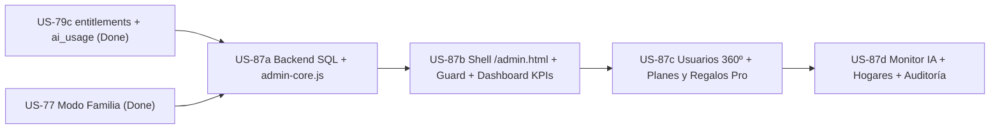

# 🛠️ Plan Detallado — US-87: Sabory Admin (Panel Web/PWA de Administración y Backoffice)

> **Historias cubiertas**: `US-87a` → `US-87d` (hijas de la épica `US-87`).
> **Objetivo**: dotar a Franky y al equipo administrador de Sabory de una consola web/PWA segura y dedicada (`/admin.html` + `src/admin/`) para gestionar usuarios, planes/regalos Pro (`entitlements`), consumo y costes de IA (`ai_usage`), hogares familiares (`households`) y métricas de negocio sin editar SQL a mano.
> **Estado del código de referencia**: `v2.02` (las tablas base están definidas en [`replica/schema.sql`](../replica/schema.sql)).

---

## 0. Reglas para el agente que implemente estas historias

1. **Lee `AGENTS.md` antes de empezar.** Explica a Franky qué vas a hacer y **espera su confirmación explícita** antes de tocar código.
2. **Una historia cada vez, en orden**: `87a → 87b → 87c → 87d`. No adelantes trabajo de la siguiente historia.
3. **Al empezar una historia**: pásala a `In Progress` en `BACKLOG.md` (modificando desde terminal para no abrir pestañas), ejecuta `.\sync-backlog.ps1 -UpdateExisting` si procede, y haz commit y push a `main`.
4. **Al terminar**: sube la versión con `node scripts/bump-version.mjs <siguiente>` (ej. `2.03`), ejecuta `npm test`, haz commit y push a `main` y **verifica que el workflow `CI & Quality Gate` termina en `success`**. Si falla, inspecciona el log de Vitest y corrige.
5. La historia queda en `In Progress` hasta que **Franky** la pruebe y la apruebe explícitamente.
6. Todo texto visible al usuario en la UI va por i18n (`i18n.js`, claves en **`es` y `en`**). Nunca hardcodees textos nuevos en HTML sin `data-i18n`.
7. Los cambios de base de datos se añaden **de forma idempotente** (`if not exists`, `drop policy if exists`, `create or replace function`, …) al final de [`replica/schema.sql`](../replica/schema.sql) como **§12**, y se guarda una copia lista para ejecutar en `supabase/sql/us87a.sql`. **Franky ejecuta ese SQL a mano** en el SQL Editor de Supabase: indícaselo claramente al terminar `US-87a`.
8. Nunca uses `service_role` ni claves privadas en el navegador (`/admin.html`, `src/admin/*.js`). Toda autorización administrativa se valida en PostgreSQL con `public.is_admin()` dentro de funciones `security definer`.
9. La lógica pura de cálculo, validación y formato va en `src/admin/admin-core.js` (ESM puro sin dependencias de DOM) para testearla de forma determinista con Vitest.

---

## 1. Decisiones de arquitectura y seguridad

| # | Decisión | Justificación |
| :--- | :--- | :--- |
| A1 | **Web/PWA dedicada en `/admin.html`** dentro del mismo repositorio | Reutiliza `config.js`, los tokens editoriales de `styles.css` (Alabastro / Warm Dusk) e `i18n.js`. Se despliega automáticamente en `https://sabory.food/admin.html` sin servidores adicionales y queda **aislada de `app.js`** para no engordar la app de los usuarios finales ni exponer UI de administración en la app principal. |
| A2 | **No indexable y fuera del precache público** | `admin.html` incluye `<meta name="robots" content="noindex, nofollow">`. No se añade a `ASSETS_TO_CACHE` en `sw.js` para mantener ligero el precache de los usuarios finales (si en el futuro se instala como PWA aparte, usará `admin-manifest.json` propio). |
| A3 | **Autorización Zero-Trust en Supabase (`admin_users` + `is_admin()`)** | El administrador inicia sesión con su cuenta real de Supabase Auth (Google o Email/Password). Las tablas `public.admin_users` y `public.admin_audit_log` tienen RLS estricto sin políticas de escritura desde cliente. Todas las RPCs `admin_*` son `security definer` y ejecutan `if not public.is_admin() then raise exception 'FORBIDDEN' using errcode = '42501'; end if;` en la primera línea. |
| A4 | **Auditoría obligatoria (`admin_audit_log`)** | Cualquier mutación (regalar/revocar Pro, resetear cuota, transferir/modificar hogar, borrar datos de usuario) inserta automáticamente un registro inmutable en `public.admin_audit_log` con `admin_id`, `action`, `target_user_id` y `payload` JSON. |
| A5 | **Reset de cuota sin perder trazabilidad financiera** | `consume_ai_quota` y `get_ai_quota_status` cuentan filas de `ai_usage` con `status in ('pending','ok')`. Para resetear la cuota de un usuario sin destruir el histórico de tokens consumidos (coste Gemini), `ai_usage.status` se amplía para aceptar `'reset'` y la RPC `admin_reset_user_ai_quota` cambia esas filas del periodo actual a `status = 'reset'`. |
| A6 | **Protección anti-autobloqueo y protección de cuentas admin** | `admin_delete_user_data(p_user_id)` rechaza borrar la cuenta del propio administrador activo (`p_user_id = auth.uid()`) o de cualquier otro usuario listado en `public.admin_users`. |

---

## 2. Mapa de archivos a crear / tocar

| Elemento | Archivo | Historia |
| :--- | :--- | :--- |
| Esquema SQL §12 + script ejecutable | `replica/schema.sql`, `supabase/sql/us87a.sql`, `supabase/sql/grant-admin-access.sql` | `US-87a` |
| Lógica pura (costes IA, MRR, validadores) | `src/admin/admin-core.js` | `US-87a` |
| Tests backend y seguridad SQL | `tests/admin-backend.test.js` | `US-87a` |
| Shell HTML + CSS + controlador admin | `admin.html`, `src/admin/admin-app.js`, `styles.css`, `i18n.js` | `US-87b` |
| Tests guard + Dashboard KPIs | `tests/admin-dashboard.test.js` | `US-87b` |
| Directorio de usuarios, Ficha 360º y Regalos Pro | `admin.html`, `src/admin/admin-app.js`, `styles.css`, `i18n.js` | `US-87c` |
| Tests usuarios + planes/regalos | `tests/admin-users-plans.test.js` | `US-87c` |
| Monitor IA, Reset de cuotas, Hogares y Auditoría | `admin.html`, `src/admin/admin-app.js`, `styles.css`, `i18n.js` | `US-87d` |
| Tests monitor IA + hogares + auditoría | `tests/admin-ai-households.test.js` | `US-87d` |

---

## 3. US-87a — Backend Admin Seguro y Lógica Pura (`admin-core.js`)

**Objetivo**: dejar blindada la capa de base de datos, las RPCs administrativas y los cálculos puros antes de construir la interfaz.

### 3.1 Base de datos (`replica/schema.sql` §12 y `supabase/sql/us87a.sql`)

```sql
-- 12. PANEL DE ADMINISTRACIÓN / BACKOFFICE (US-87a)

-- Ampliar ai_usage.status para soportar reseteo administrativo sin perder histórico de tokens
do $$
declare
  c_name text;
begin
  select con.conname into c_name
  from pg_constraint con
  join pg_class rel on rel.oid = con.conrelid
  join pg_namespace nsp on nsp.oid = rel.relnamespace
  where nsp.nspname = 'public'
    and rel.relname = 'ai_usage'
    and con.contype = 'c'
    and pg_get_constraintdef(con.oid) ilike '%status%';

  if c_name is not null then
    execute format('alter table public.ai_usage drop constraint %I', c_name);
  end if;
  alter table public.ai_usage
    add constraint ai_usage_status_check check (status in ('pending','ok','error','reset'));
end $$;

create table if not exists public.admin_users (
  user_id uuid primary key references auth.users(id) on delete cascade,
  email text not null default '',
  role text not null default 'admin' check (role in ('superadmin','admin','support')),
  created_at timestamptz not null default now()
);
alter table public.admin_users enable row level security;
drop policy if exists "Admins read own row" on public.admin_users;
create policy "Admins read own row" on public.admin_users
  for select using (auth.uid() = user_id);
-- Sin políticas de insert/update/delete: solo modificable desde el SQL Editor / service_role.

create table if not exists public.admin_audit_log (
  id bigint generated always as identity primary key,
  admin_id uuid not null references auth.users(id) on delete cascade,
  action text not null,
  target_user_id uuid,
  payload jsonb not null default '{}'::jsonb,
  created_at timestamptz not null default now()
);
create index if not exists admin_audit_log_created_idx on public.admin_audit_log (created_at desc);
create index if not exists admin_audit_log_target_idx on public.admin_audit_log (target_user_id, created_at desc);
alter table public.admin_audit_log enable row level security;

create or replace function public.is_admin() returns boolean
language sql stable security definer set search_path = public as $$
  select auth.uid() is not null and exists (
    select 1 from public.admin_users a where a.user_id = auth.uid()
  );
$$;
revoke execute on function public.is_admin() from public, anon;
grant execute on function public.is_admin() to authenticated;

drop policy if exists "Admins read audit log" on public.admin_audit_log;
create policy "Admins read audit log" on public.admin_audit_log
  for select using (public.is_admin());
-- Sin políticas de escritura cliente: solo insertan las RPCs security definer.
```

### 3.2 Catálogo de RPCs Administrativas (`security definer`)

Todas las funciones llevan `security definer set search_path = public, auth`, comprueban `if not public.is_admin() then raise exception 'FORBIDDEN' using errcode = '42501'; end if;` al inicio, y se protegen con `revoke execute ... from public, anon; grant execute ... to authenticated;`:

1. **`admin_get_dashboard_stats(p_days int default 30)` → `jsonb`**:
   - `users`: `total`, `dau` (`last_sign_in_at >= now() - interval '1 day'`), `wau` (`7 days`), `mau` (`30 days`), `new_7d`, `new_30d`.
   - `plans`: `free`, `play_monthly`, `play_annual`, `trial`, `gift`, `admin`, `household_pro`, `on_hold`, `canceled_active`.
   - `catalog`: `total_recipes`, `total_meal_plans`, `total_shopping_items`, `total_households`, `paused_households`.
   - `top_domains`: array top 15 de `source_domain` en `recipes` (excluyendo vacío, con `count`).
   - `ai`: totales de `ai_usage` hoy y en los últimos `p_days` días (`calls_total`, `calls_ok`, `calls_error`, `calls_reset`), más desglose agrupado por `(feature, model)` con `calls`, `ok_calls`, `error_calls`, `prompt_tokens`, `output_tokens`.
   - `ai_heavy_users`: top 15 usuarios por llamadas en las últimas 24h y últimos 7 días.
   - `ai_free_capped_users`: usuarios `free` que han alcanzado su tope de `weekly_plan` (≥1/sem), `guided_query` (≥3/día) o `import_ai` (≥3/mes) en el periodo actual.

2. **`admin_list_users(p_search text default '', p_plan text default 'all', p_source text default 'all', p_status text default 'all', p_limit int default 25, p_offset int default 0)` → `jsonb`**:
   - Une `auth.users` (solo `id`, `email`, `created_at`, `last_sign_in_at`, nombre de `raw_user_meta_data`) con `entitlements`, `effective_plan(u.id)`, `user_settings`, pertenencia a hogar (`household_members` / `households`) y conteos agregados (`recipes_count`, `ai_calls_30d`).
   - Devuelve `{ total, limit, offset, items: [...] }`.

3. **`admin_get_user_detail(p_user_id uuid)` → `jsonb`**:
   - Perfil completo no sensible de `auth.users`, fila de `entitlements`, `effective_plan`, `via_household`, `user_settings` (`dietary_preferences`, `nutrition_goals`, `default_servings`, `active_household_id`), conteos de `recipes`, `meal_plans`, `shopping_items`, cuotas actuales de `ai_usage` (día/semana/mes), consumo total de tokens (30d), datos de su hogar y últimos 20 eventos de `admin_audit_log` para ese `target_user_id`.

4. **`admin_set_user_entitlement(p_user_id uuid, p_plan text, p_source text, p_status text default 'active', p_days int default null, p_notes text default '')` → `jsonb`**:
   - Valida `p_plan in ('free','pro')`, `p_source in ('none','play','gift','admin')`, `p_status in ('active','grace','on_hold','canceled','expired')`.
   - Calcula `period_end`: si `p_plan = 'free'` → `now()` (o `null` con `status='expired'`); si `p_source = 'admin'` y `p_days is null` → `null` (permanente); si `p_days > 0` → `greatest(coalesce(existing.period_end, now()), now()) + make_interval(days => p_days)` cuando es extensión o `now() + make_interval(days => p_days)`.
   - Hace `upsert` en `public.entitlements` e inserta registro en `public.admin_audit_log` (`action = 'set_entitlement'`).

5. **`admin_reset_user_ai_quota(p_user_id uuid, p_feature text default 'all', p_notes text default '')` → `jsonb`**:
   - Valida `p_feature in ('all','weekly_plan','guided_query','import_ai','chat','voice')`.
   - Marca como `status = 'reset'` las filas `status in ('pending','ok')` del usuario en el periodo vigente de cada feature (zona `Europe/Madrid`: día para `guided_query`/`chat`/`voice`, semana ISO para `weekly_plan`, mes para `import_ai`).
   - Registra `action = 'reset_ai_quota'` con el número de filas reseteadas en `admin_audit_log`.

6. **`admin_list_households(p_search text default '', p_limit int default 25, p_offset int default 0)` → `jsonb`**:
   - Lista hogares con `id`, `name`, `invite_code`, `owner_id`, `owner_email`, `owner_has_pro` (`public.has_own_pro(h.owner_id)`), `members_count`, `recipes_count`, `created_at` y array de miembros.

7. **`admin_manage_household(p_household_id uuid, p_action text, p_target_user_id uuid default null)` → `jsonb`**:
   - Soporta:
     - `'transfer_owner'`: verifica que `p_target_user_id` es miembro del hogar, actualiza `households.owner_id` y roles en `household_members`.
     - `'remove_member'`: expulsa a `p_target_user_id` (si no es el titular actual) y limpia su `user_settings.active_household_id` si apuntaba a ese hogar.
     - `'regenerate_code'`: genera un nuevo `invite_code` único de 6–8 caracteres.
   - Registra `action = 'manage_household'` en `admin_audit_log`.

8. **`admin_delete_user_data(p_user_id uuid, p_mode text default 'wipe_data', p_notes text default '')` → `jsonb`**:
   - Bloquea si `p_user_id = auth.uid()` o si `exists (select 1 from public.admin_users where user_id = p_user_id)`.
   - `'wipe_data'`: elimina filas de `recipes`, `meal_plans`, `shopping_items`, `user_settings`, `household_members`, `ai_usage`, `entitlements` del usuario (mantiene cuenta Auth).
   - `'delete_account'`: tras limpiar dependencias/hogares vacíos, elimina el usuario de `auth.users` (cascada completa) y registra la auditoría conservando `target_user_id`.

9. **`admin_list_audit_log(p_limit int default 50, p_offset int default 0)` → `jsonb`**:
   - Devuelve los últimos eventos de `admin_audit_log` enriquecidos con `admin_email` y `target_email`.

**Plantilla `supabase/sql/grant-admin-access.sql`** (para que Franky se dé alta como `superadmin`):
```sql
insert into public.admin_users (user_id, email, role)
select id, email, 'superadmin'
from auth.users
where email = 'FRANKY@EMAIL.COM'
on conflict (user_id) do update set
  email = excluded.email,
  role = 'superadmin';
```

### 3.3 Lógica pura en `src/admin/admin-core.js`

- `GEMINI_PRICING_USD`: mapa de precios estimados por 1M de tokens (`inputPer1M`, `outputPer1M`) para `gemini-3.8-flash`, `gemini-3.5-flash-lite`, `gemini-3.1-flash-lite` y `default`.
- `estimateAiRowCostUsd(row)` y `summarizeAiUsage(rows, eurPerUsd = 0.92)` → devuelve totales de llamadas, `ok`, `error`, `promptTokens`, `outputTokens`, `costUsd`, `costEur`, `byFeature` y `byModel`.
- `computeRevenueMetrics(plans, prices = { monthlyEur: 2.99, annualEur: 24.99 })` → calcula `paidUsers`, `mrrEur`, `arrEur`, `conversionRatePct`.
- `validateEntitlementChange({ plan, source, status, days })` → devuelve `{ ok: true }` o `{ ok: false, error }`.
- `formatAuditSummary(entry)` → traduce códigos de acción (`set_entitlement`, `reset_ai_quota`, `manage_household`, `delete_user_data`) a descripciones legibles.

### 3.4 Tests US-87a (`tests/admin-backend.test.js`)
- Verificación estática sobre `replica/schema.sql` y `supabase/sql/us87a.sql`:
  - `admin_users` y `admin_audit_log` tienen `enable row level security`;
  - no hay políticas de `insert`/`update`/`delete` para clientes en `admin_users` ni `admin_audit_log`;
  - todas las funciones `admin_*` declaran `security definer` y validan `public.is_admin()`;
  - `revoke execute ... from public, anon` presente en todas las RPCs admin;
  - existe `supabase/sql/grant-admin-access.sql`.
- Tests unitarios sobre `src/admin/admin-core.js`:
  - cálculo de costes por modelo y agregación por feature;
  - cálculo de MRR/ARR (anual prorrateado `24.99 / 12`, mensual `2.99`, regalos y admin a `0 €`) y tasa de conversión;
  - validación de combinaciones inválidas de `entitlements`.

---

## 4. US-87b — Shell `/admin.html`, Guard de Acceso Admin y Dashboard Ejecutivo

**Objetivo**: levantar el portal visual de Sabory Admin con verificación real de sesión/permisos y métricas ejecutivas en tiempo real.

### 4.1 Estructura DOM (`admin.html`)
- Misma fuente tipográfica (`Playfair Display` + `DM Sans` + `Material Symbols Outlined`) y hoja `styles.css` más estilos específicos `.admin-*`.
- `<meta name="robots" content="noindex, nofollow">`.
- **Gate de acceso (`#admin-auth-gate`)**:
  - Estado 1 (sin sesión): formulario de login con Email/Password (`#admin-login-form`) y botón Google (`#btn-admin-google-login`).
  - Estado 2 (sesión activa pero `!is_admin()`): tarjeta `#admin-forbidden-card` indicando acceso denegado para ese email y botón `#btn-admin-forbidden-signout`.
- **Shell principal (`#admin-shell`, oculto hasta validar `is_admin()`):**
  - Barra superior con isotipo Cocotte + `Sabory Admin`, email del admin activo, selector de tema (`#btn-admin-theme`), idioma (`#btn-admin-lang`), botón actualizar (`#btn-admin-refresh`) y cerrar sesión (`#btn-admin-logout`).
  - Navegación responsiva (sidebar en escritorio ≥ 900px, barra inferior compacta en móvil):
    - `#admin-nav-dashboard` (*Resumen*)
    - `#admin-nav-users` (*Usuarios y Planes*)
    - `#admin-nav-ai` (*Consumo IA*)
    - `#admin-nav-households` (*Hogares*)
    - `#admin-nav-audit` (*Auditoría*)
- **Vista Dashboard (`#admin-view-dashboard`)**:
  - KPIs de usuario y negocio: `#kpi-total-users`, `#kpi-active-users` (DAU / WAU / MAU), `#kpi-pro-users`, `#kpi-conversion-rate`, `#kpi-mrr-eur`, `#kpi-arr-eur`.
  - KPIs de IA y catálogo: `#kpi-ai-calls-today`, `#kpi-ai-cost-month`, `#kpi-ai-error-rate`, `#kpi-total-recipes`, `#kpi-total-meal-plans`, `#kpi-total-shopping-items`.
  - Bloque **Distribución de Planes** (`#admin-plan-breakdown`): Free, Google Play Mensual, Google Play Anual, Prueba 14d, Regalo (`gift`), Admin Permanente (`admin`), Pro vía Hogar (`household`), En espera/Gracia.
  - Bloque **Inteligencia de Catálogo**: Top dominios importados (`#admin-top-domains`) con barra proporcional y contador.

### 4.2 Controlador (`src/admin/admin-app.js`)
- Clase `SaboryAdminApp` (acepta `supabaseClient` inyectable para tests).
- Flujo `init()`: comprueba sesión → llama a `rpc('is_admin')` → si `true`, muestra `#admin-shell` y carga `admin_get_dashboard_stats`; si `false`, muestra `#admin-forbidden-card`.
- Manejo limpio de errores con toasts Material 3 (`#admin-toast-container`).

### 4.3 Tests US-87b (`tests/admin-dashboard.test.js`)
- Sin sesión → `#admin-auth-gate` visible, `#admin-shell` oculto, no llama a `admin_get_dashboard_stats`.
- Con sesión de usuario normal (`is_admin() === false`) → muestra `#admin-forbidden-card` y `#admin-shell` sigue oculto.
- Con sesión de admin (`is_admin() === true`) → carga y renderiza los KPIs, desglose de planes (Play, Trial, Gift, Admin, Hogar) y ranking de `source_domain`.
- Verifica `<meta name="robots" content="noindex, nofollow">` en `admin.html` y paridad i18n (`es`/`en`) para claves `admin.*`.

---

## 5. US-87c — Gestión 360º de Usuarios, Planes (`entitlements`) y Regalos Pro

**Objetivo**: sustituir por completo las consultas SQL manuales de `grant-pro-gift.sql` por una vista operativa completa de usuarios y suscripciones.

### 5.1 Directorio de Usuarios (`#admin-view-users`)
- Barra de búsqueda `#admin-users-search` (email, nombre o UUID con debounce de 250ms).
- Selectores de filtro: `#admin-filter-plan` (`all|free|pro`), `#admin-filter-source` (`all|none|play|gift|admin|household`), `#admin-filter-status` (`all|active|grace|on_hold|canceled|expired`).
- Tabla responsiva / tarjetas móviles `#admin-users-list` mostrando: nombre + email, badge de plan efectivo (ej. `Pro · Regalo`, `Pro · Play`, `Pro · Hogar`, `Free`), caducidad (`period_end`), último acceso, nº de recetas y llamadas IA (30d).
- Controles de paginación (`#btn-users-prev`, `#btn-users-next`, `#admin-users-count`).

### 5.2 Ficha 360º y Acciones de Plan (`<dialog id="modal-admin-user">`)
- Datos de perfil, UUID copiable, fechas de alta y último login.
- Preferencias y actividad: raciones por defecto, dietas, metas nutricionales, nº de recetas / planes / ítems de compra, hogar vinculado (con enlace para abrir el hogar).
- **Panel de Plan y Regalos Pro**:
  - Botones rápidos en 1 clic:
    - `#btn-admin-gift-14d` → `pro`, `gift`, `active`, `14` días
    - `#btn-admin-gift-30d` → `pro`, `gift`, `active`, `30` días
    - `#btn-admin-gift-90d` → `pro`, `gift`, `active`, `90` días
    - `#btn-admin-gift-365d` → `pro`, `gift`, `active`, `365` días
    - `#btn-admin-grant-permanent` → `pro`, `admin`, `active`, `null` días
    - `#btn-admin-revoke-pro` → `free`, `none`, `expired`, `0` días (con confirmación si `source === 'play'` advirtiendo de no desincronizar Google Play sin motivo).
  - Formulario personalizado: selector de días (`#input-admin-gift-days`), motivo/nota interna (`#input-admin-entitlement-notes`) y botón `#btn-admin-apply-entitlement`.
  - Si `source === 'play'`: muestra `play_product_id`, `is_trial` y aviso informativo sobre facturación gestionada por Google Play.
- **Zona de Soporte / GDPR**: botón `#btn-admin-wipe-user-data` y `#btn-admin-delete-user` protegidos con modal de confirmación (`<dialog id="modal-admin-confirm">`) que exige confirmación explícita.
- **Historial del usuario**: últimas acciones registradas en `admin_audit_log`.

### 5.3 Tests US-87c (`tests/admin-users-plans.test.js`)
- Búsqueda y filtrado llaman a `admin_list_users` con los parámetros exactos y renderizan badges correctos.
- Abrir ficha de usuario llama a `admin_get_user_detail`.
- Clic en `#btn-admin-gift-90d` invoca `admin_set_user_entitlement` con `p_plan: 'pro', p_source: 'gift', p_days: 90`, refresca el detalle y muestra toast.
- Clic en `#btn-admin-grant-permanent` invoca `p_source: 'admin', p_days: null`.
- Clic en `#btn-admin-revoke-pro` en usuario `play` solicita confirmación adicional antes de ejecutar.
- Confirmar `wipe_data` llama a `admin_delete_user_data`.

---

## 6. US-87d — Monitor de IA, Reset de Cuotas, Hogares y Auditoría

**Objetivo**: visibilidad financiera sobre el gasto real de Gemini, control anti-abuso, soporte directo para Modo Familia y trazabilidad de cambios.

### 6.1 Monitor de IA (`#admin-view-ai`)
- Selector de rango temporal (`#admin-ai-range`: hoy, 7 días, 30 días).
- Tarjetas financieras: llamadas totales, tokens totales (input/output), **coste estimado USD/EUR**, ingreso mensual estimado vs. gasto IA (margen).
- Tablas de desglose por **Feature** (`weekly_plan`, `guided_query`, `import_ai`, `chat`, `voice`) y por **Modelo** (`gemini-3.8-flash`, `gemini-3.5-flash-lite`, `gemini-3.1-flash-lite`), mostrando tasa de error.
- **Heavy Users** (`#admin-ai-heavy-users`): usuarios más cercanos al tope de 200 llamadas/día.
- **Usuarios Free con Cuota Agotada** (`#admin-ai-free-capped`): lista accionable con botón rápido para **Resetear cuota** o **Abrir ficha / Regalar Pro**.
- Acción **Resetear Cuota IA** (disponible también en la ficha 360º del usuario): selector de feature (`all`, `weekly_plan`, `guided_query`, `import_ai`) + botón `#btn-admin-reset-quota` que invoca `admin_reset_user_ai_quota`.

### 6.2 Consola de Hogares (`#admin-view-households`)
- Buscador `#admin-households-search` (nombre o `invite_code`).
- Lista `#admin-households-list` con indicador visual **Activo** vs. **En Pausa** (según `has_own_pro(owner_id)`), titular, código de invitación y miembros.
- Modal de hogar `<dialog id="modal-admin-household">`:
  - Lista de miembros con rol (`owner`/`member`).
  - Botón **Hacer titular** (`transfer_owner`) junto a cada miembro.
  - Botón **Expulsar** (`remove_member`) con confirmación.
  - Botón **Regenerar código** (`regenerate_code`).

### 6.3 Registro de Auditoría (`#admin-view-audit`)
- Tabla cronológica `#admin-audit-list` cargada desde `admin_list_audit_log`, mostrando fecha, admin responsable, acción formateada, usuario afectado y notas/payload.

### 6.4 Tests US-87d (`tests/admin-ai-households.test.js`)
- Renderizado de costes estimados de IA por modelo y feature, más cálculo de margen.
- Listado de heavy users y usuarios Free en tope de cuota.
- Acción de reset de cuota llama a `admin_reset_user_ai_quota` con `p_user_id` y `p_feature`.
- Consola de hogares: distingue hogar activo vs. en pausa y ejecuta `admin_manage_household` para `transfer_owner`, `remove_member` y `regenerate_code`.
- Vista de auditoría renderiza correctamente los eventos de `admin_list_audit_log`.

---

## 7. Resumen de dependencias


